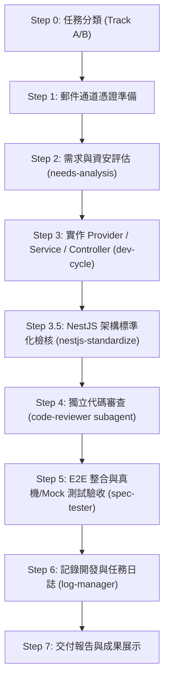

# 真實 Email 發送與忘記密碼/密碼重設開發守則與 Dev-Workflow SOP

> **版本**：v1.0.0  
> **最後更新**：2026-08-27  
> **作者**：uberMenu 後端架構團隊  
> **狀態**：正式規範 (Official Standard)  
> **適用範圍**：NestJS 10+、TypeScript 5+、PostgreSQL、Prisma、Nodemailer / Resend / AWS SES

---

## 1. 規範目的與核心目標 (Purpose & Core Objectives)

本規範旨在為 Enterprise NestJS 後端系統建立一套**真正具備生產環境交付能力、高安全性、職責解耦且可抽換供應商**的「真實 Email 發送與忘記密碼重設 (Password Reset & Mail Delivery)」開發守則。

### 核心目標
1. **真實投遞能力 (Real Mail Delivery)**：支援主流郵件通道（自建 SMTP、Gmail App Password、Resend、AWS SES、SendGrid），提供真正可寄送至使用者收件匣的郵件能力。
2. **銀行級資安防禦 (Bank-Grade Security)**：防範帳號列舉攻擊 (User Enumeration)、爆破枚舉 (Brute Force)、重放攻擊 (Replay Attack) 與時序攻擊 (Timing Attack)。
3. **介面抽象與動態解耦 (Decoupled Provider Architecture)**：遵守專案架構鐵律，將「郵件發送器」抽離為 `IMailProvider` 抽象介面，支援依環境變數動態切換通道與測試 Mock 模式。
4. **標準化 Dev-Workflow**：完整融入 `dev-workflow.md` 之 Step 0 ~ Step 7 研發流程。

---

## 2. 資安鐵律與防禦規範 (Security Directives)

### 2.1 防範帳號列舉攻擊 (Anti-User Enumeration Rule)
- **原則**：無論使用者輸入的 Email 在資料庫中是否存在，`POST /api/v1/auth/forgot-password` 端點的 HTTP 狀態碼、回應時間與 JSON Envelope 必須**完全一致**。
- **作法**：
  - 若查無該用戶：內部靜默跳過寄信步驟，但仍回傳 `200/201 OK` 與統一訊息：`"若此電子郵件已註冊，我們已發送密碼重設信件至您的信箱"`。
  - **嚴禁**拋出 `NotFoundException('查無此電子郵件')`，防止惡意攻擊者透過 API 掃描探測系統註冊名冊。

### 2.2 OTP / Reset Token 安全生成與儲存 (Token Hashing Rule)
1. **密碼學安全亂數 (CSPRNG)**：
   - 6 位數純數字驗證碼：必須使用 Node.js 原生 `crypto.randomInt(100000, 999999).toString()` 生成，**嚴禁**使用 `Math.random()`。
   - URL 安全 Token：使用 `crypto.randomBytes(32).toString('hex')`。
2. **禁止明文儲存驗證碼 (Hash Stored Tokens)**：
   - 伺服器端（DB 或 Redis）存儲的驗證碼，必須先經過 `SHA-256` 雜湊（或 Argon2/Bcrypt）。
   - 即使資料庫意外洩漏，攻擊者也無法直接取得有效驗證碼。
3. **驗證比對防時序攻擊**：
   - 驗證使用者輸入之驗證碼時，採用 `crypto.timingSafeEqual` 比對兩者 Hash 值。

### 2.3 頻率限制與過期時間 (Rate Limiting & TTL)
- **驗證碼有效期 (TTL)**：嚴格限制為 **10 ~ 15 分鐘**。過期後自動失效。
- **寄信冷卻時間 (Cooldown)**：同一 Email 限制 **60 秒內** 僅能請求發送一次，避免郵件伺服器被刷爆或觸發垃圾郵件過濾。
- **最大嘗試次數 (Max Attempts)**：同一 Email 驗證碼錯誤輸入達 **5 次**，系統必須立即銷毀該 OTP 並強制該用戶重新發起申請。

### 2.4 一次性使用與會話作廢 (One-Time-Use & Session Invalidation)
- 密碼一旦重設成功：
  1. 立即從 DB/Redis 刪除該 OTP / Token。
  2. 立即將該用戶資料庫內的 `tokenVersion` 遞增或廢除所有活躍的 Refresh Token，強制使該帳號所有已登入的裝置登出，防範帳號被盜。

---

## 3. 模組架構與 Provider 解耦設計 (Decoupled Architecture)

符合 NestJS Enterprise DDD 規範，寄信功能必須獨立封裝在 `src/shared/mail/` 或 `src/modules/mail/`：

```text
src/shared/mail/
├── dto/
│   └── send-mail.dto.ts              # 寄信參數傳輸物件
├── interfaces/
│   ├── mail-provider.interface.ts     # IMailProvider 抽象契約
│   └── mail-options.interface.ts      # 郵件內容介面
├── providers/
│   ├── smtp-mail.provider.ts          # Nodemailer SMTP 實作 (Gmail, SES, Mailtrap)
│   ├── resend-mail.provider.ts        # Resend REST API 實作 (可選)
│   └── mock-mail.provider.ts          # 測試與離線除錯 Mock 實作
├── templates/
│   └── password-reset.template.ts     # RWD 響應式 HTML 郵件模板
├── services/
│   └── mail.service.ts                # 郵件業務服務 (模板合成與發送協調)
└── mail.module.ts                     # 模組註冊與動態 Provider Factory
```

### 3.1 抽象介面定義 (`IMailProvider`)
```typescript
export interface SendMailOptions {
  to: string;
  subject: string;
  html: string;
  text?: string;
}

export const MAIL_PROVIDER_TOKEN = 'MAIL_PROVIDER_TOKEN';

export interface IMailProvider {
  /** 發送電子郵件 */
  sendMail(options: SendMailOptions): Promise<void>;
  /** 檢查郵件通道連線健康狀態 */
  verifyConnection?(): Promise<boolean>;
}
```

---

## 4. 環境變數驅動 (`.env`) 配置

系統必須支援無縫切換寄件驅動與測試模式：

```env
# ===================================
# Mail Service Configuration
# ===================================
# 郵件驅動通道: smtp | resend | mock
MAIL_PROVIDER=smtp

# 是否開啟除錯 Mock 模式 (true 時不實際寄信，僅於 Console 印出預覽)
MAIL_DEBUG_MOCK=false

# 寄件者名稱與信箱
MAIL_FROM="uberMenu 營運團隊 <no-reply@ubermenu.com>"

# --- SMTP 通道配置 (適用 Gmail / Mailtrap / AWS SES SMTP) ---
MAIL_HOST=smtp.gmail.com
MAIL_PORT=587
MAIL_SECURE=false
MAIL_USER=your-service-account@gmail.com
# Gmail 必須使用「應用程式密碼 (App Password)」，非一般登入密碼
MAIL_PASS=xxxx-xxxx-xxxx-xxxx

# 前端密碼重設頁面 Base URL
FRONTEND_RESET_PASSWORD_URL=http://localhost:5173/reset-password
```

---

## 5. 核心代碼實作範例 (Reference Implementation)

### 5.1 SMTP 郵件驅動實作 (`smtp-mail.provider.ts`)

```typescript
import { Injectable, Logger } from '@nestjs/common';
import * as nodemailer from 'nodemailer';
import type { Transporter } from 'nodemailer';
import { IMailProvider, SendMailOptions } from '../interfaces/mail-provider.interface';

@Injectable()
export class SmtpMailProvider implements IMailProvider {
  private readonly transporter: Transporter;
  private readonly logger = new Logger(SmtpMailProvider.name);

  constructor() {
    this.transporter = nodemailer.createTransport({
      host: process.env.MAIL_HOST || 'smtp.gmail.com',
      port: Number(process.env.MAIL_PORT) || 587,
      secure: process.env.MAIL_SECURE === 'true',
      auth: {
        user: process.env.MAIL_USER,
        pass: process.env.MAIL_PASS,
      },
    });
  }

  async sendMail(options: SendMailOptions): Promise<void> {
    const from = process.env.MAIL_FROM || 'no-reply@ubermenu.com';
    try {
      const info = await this.transporter.sendMail({
        from,
        to: options.to,
        subject: options.subject,
        html: options.html,
        text: options.text,
      });
      this.logger.log(`Email successfully sent to ${options.to} (MessageId: ${info.messageId})`);
    } catch (error) {
      this.logger.error(`Failed to send email to ${options.to}: ${(error as Error).message}`, (error as Error).stack);
      throw error;
    }
  }

  async verifyConnection(): Promise<boolean> {
    try {
      await this.transporter.verify();
      this.logger.log('SMTP connection verified successfully.');
      return true;
    } catch (error) {
      this.logger.warn(`SMTP verification failed: ${(error as Error).message}`);
      return false;
    }
  }
}
```

### 5.2 測試與除錯 Mock 驅動實作 (`mock-mail.provider.ts`)

```typescript
import { Injectable, Logger } from '@nestjs/common';
import { IMailProvider, SendMailOptions } from '../interfaces/mail-provider.interface';

@Injectable()
export class MockMailProvider implements IMailProvider {
  private readonly logger = new Logger(MockMailProvider.name);
  public readonly sentMails: SendMailOptions[] = [];

  async sendMail(options: SendMailOptions): Promise<void> {
    this.sentMails.push(options);
    this.logger.log(`[MOCK EMAIL] To: ${options.to} | Subject: "${options.subject}"`);
    this.logger.debug(`[MOCK EMAIL HTML PREVIEW]:\n${options.html}`);
  }
}
```

### 5.3 響應式 HTML 郵件模板 (`password-reset.template.ts`)

為保證所有 Email Client (Gmail, Outlook, Apple Mail) 正常排版，必須採用 Inlined CSS：

```typescript
export function renderPasswordResetEmail(params: {
  email: string;
  code: string;
  expireMinutes: number;
  resetUrl?: string;
}): string {
  return `
<!DOCTYPE html>
<html lang="zh-TW">
<head>
  <meta charset="UTF-8">
  <meta name="viewport" content="width=device-width, initial-scale=1.0">
  <title>重設您的 uberMenu 密碼</title>
</head>
<body style="margin: 0; padding: 0; background-color: #f4f6f8; font-family: -apple-system, BlinkMacSystemFont, 'Segoe UI', Roboto, Helvetica, Arial, sans-serif;">
  <table width="100%" cellpadding="0" cellspacing="0" style="padding: 40px 20px;">
    <tr>
      <td align="center">
        <table width="100%" max-width="600" cellpadding="0" cellspacing="0" style="max-width: 600px; background-color: #ffffff; border-radius: 12px; overflow: hidden; box-shadow: 0 4px 12px rgba(0,0,0,0.06);">
          <!-- Header -->
          <tr>
            <td style="background-color: #10b981; padding: 32px 40px; text-align: center;">
              <h1 style="color: #ffffff; margin: 0; font-size: 24px; font-weight: 700; letter-spacing: 0.5px;">uberMenu 密碼重設通知</h1>
            </td>
          </tr>
          <!-- Body -->
          <tr>
            <td style="padding: 40px;">
              <p style="font-size: 16px; color: #334155; line-height: 1.6; margin-top: 0;">
                親愛的會員 <strong>${params.email}</strong> 您好：
              </p>
              <p style="font-size: 15px; color: #64748b; line-height: 1.6;">
                我們收到了您重設帳號密碼的請求。請使用下方的 6 位數驗證碼完成密碼重設程序：
              </p>
              <!-- Code Box -->
              <div style="background-color: #f8fafc; border: 2px dashed #cbd5e1; border-radius: 8px; padding: 24px; text-align: center; margin: 28px 0;">
                <span style="font-size: 36px; font-weight: 800; color: #0f172a; letter-spacing: 8px; font-family: monospace;">${params.code}</span>
              </div>
              <p style="font-size: 14px; color: #ef4444; margin: 0 0 16px 0; font-weight: 600;">
                ⚠️ 該驗證碼將在 ${params.expireMinutes} 分鐘內有效，且只能使用一次。
              </p>
              <p style="font-size: 13px; color: #94a3b8; line-height: 1.5; margin: 0;">
                若非您本人發起此操作，請忽略此郵件，您的帳號仍然是安全的。請勿將此驗證碼透露給任何人。
              </p>
            </td>
          </tr>
          <!-- Footer -->
          <tr>
            <td style="background-color: #f1f5f9; padding: 20px; text-align: center; border-top: 1px solid #e2e8f0;">
              <p style="font-size: 12px; color: #94a3b8; margin: 0;">
                © 2026 uberMenu Team. All rights reserved. 此為系統自動發送郵件，請勿直接回覆。
              </p>
            </td>
          </tr>
        </table>
      </td>
    </tr>
  </table>
</body>
</html>
`;
}
```

### 5.4 模組註冊與 Factory (`mail.module.ts`)

```typescript
import { Module } from '@nestjs/common';
import { MailService } from './services/mail.service';
import { MAIL_PROVIDER_TOKEN } from './interfaces/mail-provider.interface';
import { SmtpMailProvider } from './providers/smtp-mail.provider';
import { MockMailProvider } from './providers/mock-mail.provider';

@Module({
  providers: [
    MailService,
    {
      provide: MAIL_PROVIDER_TOKEN,
      useFactory: () => {
        const isMock =
          process.env.MAIL_DEBUG_MOCK === 'true' ||
          process.env.NODE_ENV === 'test' ||
          process.env.MAIL_PROVIDER === 'mock';

        if (isMock) {
          return new MockMailProvider();
        }
        return new SmtpMailProvider();
      },
    },
  ],
  exports: [MailService, MAIL_PROVIDER_TOKEN],
})
export class MailModule {}
```

### 5.5 AuthService 完整密碼重設業務流程整合

```typescript
import { Injectable, Logger } from '@nestjs/common';
import * as crypto from 'crypto';
import { MailService } from '../../shared/mail/services/mail.service';
import { UsersService } from '../../modules/users/services/users.service';
import { ForgotPasswordDto, VerifyResetCodeDto, ResetPasswordDto } from '../dto';

@Injectable()
export class AuthService {
  private readonly logger = new Logger(AuthService.name);
  
  // 記憶體或 Redis OTP 儲存結構 (儲存 SHA-256 Hash)
  private readonly otpStore = new Map<string, {
    hashedCode: string;
    expireAt: number;
    attempts: number;
  }>();

  constructor(
    private readonly usersService: UsersService,
    private readonly mailService: MailService,
  ) {}

  /**
   * 忘記密碼 - 申請發送驗證碼
   */
  async forgotPassword(dto: ForgotPasswordDto): Promise<{ message: string }> {
    const email = dto.email.toLowerCase().trim();
    const user = await this.usersService.findByEmail(email).catch(() => null);

    // 核心安全防禦：無論用戶是否存在，均回傳成功訊息，防止帳號列舉探測
    if (!user) {
      this.logger.warn(`Password reset requested for non-existent email: ${email}`);
      return { message: '若此電子郵件已註冊，我們已發送重設驗證信至您的信箱' };
    }

    // 檢查發送頻率 (60 秒內冷卻)
    const existing = this.otpStore.get(email);
    if (existing && Date.now() < existing.expireAt - 9 * 60 * 1000) {
      // 假設 TTL 為 10 分鐘，請求未滿 1 分鐘時
      return { message: '發送過於頻繁，請稍候再試' };
    }

    // 生成安全 6 位數 OTP
    const rawCode = crypto.randomInt(100000, 999999).toString();
    const hashedCode = crypto.createHash('sha256').update(rawCode).digest('hex');

    // 存儲 10 分鐘有效
    this.otpStore.set(email, {
      hashedCode,
      expireAt: Date.now() + 10 * 60 * 1000,
      attempts: 0,
    });

    // 觸發真實郵件寄送
    await this.mailService.sendPasswordResetMail({
      to: email,
      code: rawCode,
      expireMinutes: 10,
    });

    return { message: '若此電子郵件已註冊，我們已發送重設驗證信至您的信箱' };
  }

  /**
   * 驗證重設代碼
   */
  async verifyResetCode(dto: VerifyResetCodeDto): Promise<{ valid: boolean }> {
    const email = dto.email.toLowerCase().trim();
    const record = this.otpStore.get(email);

    if (!record || Date.now() > record.expireAt) {
      return { valid: false };
    }

    // 累加嘗試次數防禦爆破
    record.attempts += 1;
    if (record.attempts > 5) {
      this.otpStore.delete(email); // 超過 5 次直接失效
      return { valid: false };
    }

    const inputHash = crypto.createHash('sha256').update(dto.code.trim()).digest('hex');
    const isValid = crypto.timingSafeEqual(
      Buffer.from(inputHash, 'utf-8'),
      Buffer.from(record.hashedCode, 'utf-8'),
    );

    return { valid: isValid };
  }

  /**
   * 執行密碼重設
   */
  async resetPassword(dto: ResetPasswordDto): Promise<{ success: boolean; message: string }> {
    const email = dto.email.toLowerCase().trim();
    const verification = await this.verifyResetCode({ email, code: dto.code });

    if (!verification.valid) {
      throw new BadRequestException('驗證碼不正確或已逾期，請重新申請');
    }

    // 更新用戶密碼
    await this.usersService.updatePassword(email, dto.newPassword);

    // 成功後立即作廢 OTP，防止重放
    this.otpStore.delete(email);

    return { success: true, message: '密碼重設成功，請使用新密碼重新登入' };
  }
}
```

---

## 6. Dev-Workflow SOP Pipeline (Step 0 ~ Step 7)

實作真實 Email 發信與密碼重設功能時，工程團隊必須嚴格依照以下 Pipeline 推進：



### 📋 階段執行詳細守則

#### Step 0 — 任務識別
- 若現有專案僅有 Mock 且需建置真實發信服務 ➔ 歸類為 **Track B (功能升級 / 重構)**。

#### Step 1 — 郵件供應商憑證準備
- 選擇發信方式並填妥 `.env`：
  - **開發/測試**：使用 Mailtrap (SMTP: `sandbox.smtp.mailtrap.io:2525`) 或 `MAIL_DEBUG_MOCK=true`。
  - **生產/預發**：
    - **Gmail**：至 Google 帳戶 ➔ 安全性 ➔ 啟用兩步驟驗證 ➔ 建立「應用程式密碼 (App Password)」(16 碼)。
    - **AWS SES / Resend**：取得 SMTP 帳密或 API Key，並驗證寄件網域 (Domain Verification)。

#### Step 2 — 需求分析與安全邊界確認
- 確認防帳號列舉機制（查無信箱亦回傳成功）。
- 確認防爆破機制（5 次錯誤註銷、60 秒頻率限制）。
- 產出 Task Brief 寫入 `planning/tasks.md`。

#### Step 3 — 核心實作
1. 安裝驅動依賴：`pnpm add nodemailer` 與 `pnpm add -D @types/nodemailer`。
2. 實作 `IMailProvider` 與 `SmtpMailProvider`、`MockMailProvider`。
3. 實作 RWD HTML 郵件模板。
4. 注入 `MailService` 至 `AuthService.forgotPassword`。
5. 同步編寫單元測試 (`mail.service.spec.ts`, `auth.service.spec.ts`)，單元測試必須使用 `MockMailProvider` 確保在無外網連線時 `pnpm test` 全綠通過。

#### Step 3.5 — 架構標準化檢核
- 檢驗 `MAIL_PROVIDER_TOKEN` 是否完成依賴抽象。
- 檢驗 Controller 方法是否有明確宣告 TypeScript 回傳型別。
- 檢驗 DTO 是否具備 `@IsEmail()` 與長度邊界校驗。

#### Step 4 — 獨立代碼審查 (Code Review)
- 派生 `code-reviewer` Subagent 檢核：
  - [ ] 是否在任何地方洩漏了明文密碼或明文 OTP？
  - [ ] 是否存在帳號列舉安全漏洞？
  - [ ] 是否存在未捕捉的 SMTP 網路連線例外？
  - [ ] 測試是否解耦真實外部網路？

#### Step 5 — E2E 整合與驗收測試
- 撰寫 `test/auth-forgot-password.e2e-spec.ts`：
  - 測試忘記密碼申請 ➔ 驗證 `MockMailProvider` 接收到包含 6 位數代碼的 Email。
  - 測試使用該代碼驗證並更新密碼。
  - 測試過期代碼或輸入錯誤代碼時被拒絕。
  - 測試成功重設後舊代碼無法再重放使用。

#### Step 6 & 7 — 撰寫日誌與交付總結
- 更新 `.agents/dev-logs/YYYY-MM-DD.md` 與 `.agents/task-logs/email-password-reset.md`。
- 呈現可點擊的檔案連結與驗收數據。

---

## 7. 常見踩坑與生產部署檢核表 (Production Gotchas)

| 檢核項目 | 常見問題與踩坑 | 正確防禦作法 |
| :--- | :--- | :--- |
| **Gmail 阻擋連線** | 報錯 `535-5.7.8 Username and Password not accepted` | 必須開啟 Google 帳號「兩步驟驗證」，並申請專屬「應用程式密碼」，不可使用個人日常密碼。 |
| **被列為垃圾郵件 (Spam)** | 寄出的郵件直接落入用戶垃圾郵件匣 | 1. 網域 DNS 必須配置 `SPF` 記錄 (`v=spf1 include:... ~all`)。<br>2. 設定 `DKIM` 數位簽名與 `DMARC` 策略。<br>3. HTML 郵件內文避免全大寫聳動字眼，並提供純文字 Fallback (`text`)。 |
| **API 連線卡頓 (Thread Blocking)** | SMTP 握手與寄信需耗時 1~3 秒，導致使用者端請求卡死 | 在高並發架構下，寄信作業應改由 **BullMQ / Redis 訊息佇列** 非同步處理；Controller 僅負責投遞 Job 即刻回覆客戶端。 |
| **CI/CD 自動化測試失敗** | 跑 GitHub Actions 或 `pnpm test` 時因無 SMTP 帳密拋錯崩潰 | 在測試環境 (`NODE_ENV=test`) 強制使用 `MockMailProvider`，不得依賴任何真實外部郵件連線。 |
| **跨來源前端連結** | 郵件內的重設連結導向 `localhost` 或錯誤域名 | 透過環境變數 `FRONTEND_RESET_PASSWORD_URL` 動態拼接完整網址，支援多環境部署。 |
