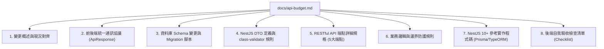

# 實作計畫：預算系統 (Budget Domain) 後端與資料庫「已使用金額 (usedAmount)」修改技術規格書

## 1. 任務背景與目標 (Context & Goal)

### 1.1 背景說明
前端目前在 `src/domain/budget` 已完成以下升級：
- 預算表單 [`BudgetFormModal.vue`](file:///C:/Users/benja/Desktop/project/uberMenu/src/domain/budget/components/BudgetFormModal.vue) 具備「已使用金額 (TWD)」手動輸入欄位。
- 前端 Zod 驗證 [`budget.schema.ts`](file:///C:/Users/benja/Desktop/project/uberMenu/src/domain/budget/schemas/budget.schema.ts) 已加入 `usedAmount`（非負數校驗、可選、預設為 0）。
- 業務邏輯層 [`useBudget.ts`](file:///C:/Users/benja/Desktop/project/uberMenu/src/domain/budget/composables/useBudget.ts) 已徹底拔除偽亂數產生器，改以真實 `usedAmount` 動態計算使用進度與儀表板加總。

### 1.2 現存問題
後端伺服器與資料庫目前**完全沒有建立** `usedAmount` 選項與資料庫欄位：
1. 資料庫（`budgets` 資料表）缺少 `used_amount` 欄位。
2. 後端傳輸物件 `CreateBudgetDto` 與 `UpdateBudgetDto` 未宣告 `usedAmount` 屬性與 `class-validator` 驗證裝飾器。
3. 後端實體與 ORM Mapping（Prisma / TypeORM）未映射該欄位，導致前端送出之 `usedAmount` 在後端持久化時被遺漏（Strip），查詢時亦無法回傳。

### 1.3 核心目標
依據專案規範與企業級標準，在 [`docs/api-budget.md`](file:///C:/Users/benja/Desktop/project/uberMenu/docs/api-budget.md) 撰寫一份**詳盡、易懂且具備高度實作參考價值的後端修改技術規格文件**，供後端工程師迅速落地資料庫遷移、DTO 擴充、業務邏輯與 API 端點對接。

---

## 2. 使用者審查項目 (User Review Required)

> [!IMPORTANT]
> **資料庫數值精度與超支處理規範**：
> 1. **資料型態建議**：建議採用 `DECIMAL(12, 2)` 或 `NUMERIC(12, 2)`，避免 IEEE 754 浮點數精度遺失問題。
> 2. **允許超支 (Over-budget)**：財務實務上實際支出可能大於預算金額（例如預算 5,000，實際使用 6,200）。前端 UI 會呈現進度 > 100% 之紅色警示，後端與資料庫**僅限制 `used_amount >= 0`，不應強制限制 `used_amount <= amount`**。
> 3. **預設值與相容性**：資料庫設定 `DEFAULT 0.00`，DTO 設為可選並預設為 `0`，既有資料自動補 0，不影響舊客戶端與既有資料。

---

## 3. 開放性問題與決策 (Open Questions)

*目前架構與規格已十分明確（完全對齊前端既有 `src/domain/budget` 實作與專案 `docs/api-project-scheduler.md` / `userbackend.md` 規範），無阻塞性問題。*

---

## 4. 變更方案與內容規劃 (Proposed Changes)

本任務為**文件撰寫與後端技術規格輸出**（Track B 規格文件擴充）：

```
docs/
└── api-budget.md        # [NEW] 預算管理 (Budget Domain) 後端技術規格書與資料庫修改指南
.agents/
├── planning/tasks.md    # [MODIFY] 登記本次規格書編寫任務與驗收清單
└── dev-logs/2026-09-04.md# [MODIFY] 記錄規格書產出與設計決策日誌
```

---

### 4.1 新增文件：`docs/api-budget.md` 大綱結構

本規格書將參照專案最佳實踐文件（如 [`docs/api-project-scheduler.md`](file:///C:/Users/benja/Desktop/project/uberMenu/docs/api-project-scheduler.md) 與 [`userbackend.md`](file:///C:/Users/benja/Desktop/project/uberMenu/userbackend.md)），包含以下八大核心章節：



#### 第 1 章：變更概述與現況對齊 (Overview)
- 前端現況：說明 Vue 3 前端已在 `src/domain/budget` 實作表單手動輸入與表格呈現。
- 後端痛點：資料庫缺少 `used_amount`、後端 DTO 缺少該屬性。
- 交付成果定義：包含 DB Migration、DTO、Controller、Service 修改內容。

#### 第 2 章：前後端統一通訊協議 (API Standard)
- Base URL：`/api/budgets`
- 封裝格式：`ApiResponse<T>`（`success: boolean`, `res_code: "111"`, `message: string`, `ts: string`, `res_body: T`）。
- 異常格式：`ApiErrorResponse`。

#### 第 3 章：資料庫 Schema 變更與 Migration 腳本 (Database Migration)
- 資料表名稱：`budgets`
- 變更欄位：新增 `used_amount DECIMAL(12, 2) NOT NULL DEFAULT 0.00`
- 約束（Constraints）：
  - `CHECK (used_amount >= 0)`
  - `CHECK (amount >= 0)`
  - `CHECK (end_date >= start_date)`
- Migration 語法：
  - **PostgreSQL 語法**：`ALTER TABLE budgets ADD COLUMN used_amount NUMERIC(12, 2) NOT NULL DEFAULT 0.00;`
  - **MySQL 語法**：`ALTER TABLE budgets ADD COLUMN used_amount DECIMAL(12, 2) NOT NULL DEFAULT 0.00;`
  - **Prisma Schema**：定義 `usedAmount Decimal @default(0.00) @map("used_amount") @db.Decimal(12, 2)`
  - **TypeORM Entity**：定義 `@Column({ type: 'decimal', precision: 12, scale: 2, default: 0 }) usedAmount: number;`

#### 第 4 章：NestJS DTO 規範與校驗 (DTOs Specification)
- `CreateBudgetDto`：
  ```typescript
  export class CreateBudgetDto {
    @IsString()
    @IsOptional()
    id?: string;

    @IsString()
    @IsNotEmpty({ message: '預算名稱不可為空' })
    title!: string;

    @IsNumber({}, { message: '預算金額必須為數值' })
    @Min(0, { message: '預算金額不得小於 0' })
    amount!: number;

    @IsNumber({}, { message: '已使用金額必須為數值' })
    @Min(0, { message: '已使用金額不得小於 0' })
    @IsOptional()
    usedAmount?: number = 0;

    @IsString()
    @IsNotEmpty({ message: '請選擇預算類別' })
    category!: string;

    @IsString()
    @Matches(/^\d{4}-\d{2}-\d{2}$/, { message: 'startDate 格式必須為 YYYY-MM-DD' })
    startDate!: string;

    @IsString()
    @Matches(/^\d{4}-\d{2}-\d{2}$/, { message: 'endDate 格式必須為 YYYY-MM-DD' })
    endDate!: string;

    @IsBoolean({ message: 'isActive 必須為布林值' })
    isActive!: boolean;
  }
  ```
- `UpdateBudgetDto`：繼承或部分覆蓋，支援可選更新。
- `BudgetResponseDto`：包含 `id`, `title`, `amount`, `usedAmount`, `category`, `startDate`, `endDate`, `isActive`, `createdAt`, `updatedAt`。

#### 第 5 章：RESTful API 端點詳細規範 (Endpoints Specification)
涵蓋 5 大完整端點（提供完整 Request Headers, Request Body, 200/400/404 Response JSON）：
1. `GET /api/budgets`：查詢預算清單（回傳項目包含 `usedAmount`）
2. `GET /api/budgets/:id`：取得單一預算明細
3. `POST /api/budgets`：建立預算（支援寫入 `usedAmount`，未帶時自動賦予 0）
4. `PUT /api/budgets/:id`：更新預算（支援更新 `usedAmount`）
5. `DELETE /api/budgets/:id`：刪除預算

#### 第 6 章：業務邏輯與邊界防護 (Business Rules)
1. 金額非負防護：`usedAmount >= 0`，`amount >= 0`。
2. 超支情境容忍：允許 `usedAmount > amount`，不可阻擋儲存。
3. 日期有效性校驗：`startDate <= endDate`。
4. 數值精度保護：避免浮點數除法/加法產生多餘小數位（如 `0.1 + 0.2 = 0.30000000000000004`）。

#### 第 7 章：NestJS 10+ 參考實作範例 (Reference Implementation)
提供開箱即用的 NestJS 程式碼片段：
- `budgets.controller.ts`
- `budgets.service.ts`（示範 Prisma 與 TypeORM 兩種持久化寫法）

#### 第 8 章：後端驗收檢查清單 (Acceptance Checklist)
列出後端工程師上線前的自查項目（資料庫 Migration 執行、舊資料補 0 驗證、API 測試、Swagger 更新等）。

---

## 5. 驗證計畫 (Verification Plan)

### 5.1 文件完整性檢查 (Document Inspection)
- 檢查 [`docs/api-budget.md`](file:///C:/Users/benja/Desktop/project/uberMenu/docs/api-budget.md) 是否詳盡覆蓋資料庫、DTO、5 大 API 端點、Prisma/TypeORM 範例與錯誤代碼。
- 檢查 Markdown 語法無誤，Mermaid 圖表正確渲染，程式碼區塊高亮完整。

### 5.2 與前端規格對齊驗證 (Cross-Verification with Frontend)
- 比對 [`src/domain/budget/types.ts`](file:///C:/Users/benja/Desktop/project/uberMenu/src/domain/budget/types.ts)
- 比對 [`src/domain/budget/schemas/budget.schema.ts`](file:///C:/Users/benja/Desktop/project/uberMenu/src/domain/budget/schemas/budget.schema.ts)
- 比對 [`src/domain/budget/services/budgetApi.ts`](file:///C:/Users/benja/Desktop/project/uberMenu/src/domain/budget/services/budgetApi.ts)
- 比對 [`src/mock/budgetMock.ts`](file:///C:/Users/benja/Desktop/project/uberMenu/src/mock/budgetMock.ts)
- 確保規格書中的 DTO 屬性名稱（`usedAmount`、`amount`、`startDate`、`endDate` 等）與前端傳輸 payload 100% 一致，無拼字或欄位型別分歧。

### 5.3 專案驗證
- 執行 `npx vue-tsc --noEmit` 與現有測試，確保既有專案代碼完全不受影響。
