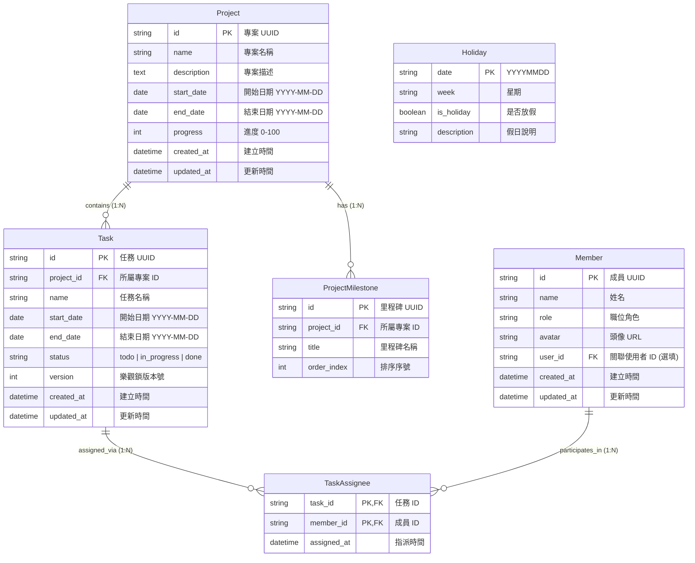
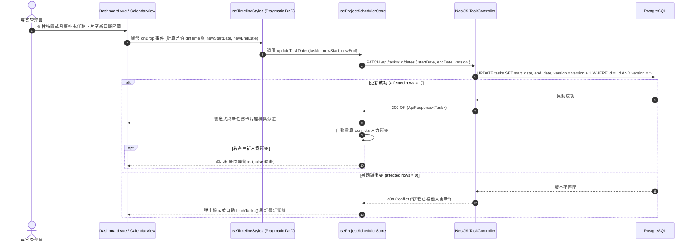

# 專案排程系統 (ProjectScheduler) 後端開發技術規格書與 SQL 簡表守則

> **版本**：v1.0.0  
> **最後更新**：2026-08-28  
> **作者**：uberMenu 系統架構團隊  
> **狀態**：正式發布 (Ready for Implementation)  
> **適用目標**：後端工程團隊（NestJS 10+ / PostgreSQL / MySQL / Prisma / TypeORM）、前端工程師、資料庫管理員 (DBA)  
> **相容前端**：`src/domain/projectScheduler`  

---

## 目錄

1. [文件概述 (Overview)](#1-文件概述-overview)
2. [API 通訊協議與統一回應規範 (API Standard)](#2-api-通訊協議與統一回應規範-api-standard)
3. [資料實體模型規格 (Domain Entity Specification)](#3-資料實體模型規格-domain-entity-specification)
4. [資料庫實體關聯圖 (Mermaid ERD) 與 Prisma Schema](#4-資料庫實體關聯圖-mermaid-erd-與-prisma-schema)
5. [SQL 簡表守則與資料庫設計規範 ⭐](#5-sql-簡表守則與資料庫設計規範-)
   - 5.1 [資料庫簡表一覽 (Table Dictionary)](#51-資料庫簡表一覽-table-dictionary)
   - 5.2 [命名規範與約定守則 (Naming Conventions)](#52-命名規範與約定守則-naming-conventions)
   - 5.3 [標準 SQL DDL 建表語法 (PostgreSQL / MySQL 相容)](#53-標準-sql-ddl-建表語法-postgresql--mysql-相容)
   - 5.4 [約束與資料完整性守則 (Data Integrity & Constraints)](#54-約束與資料完整性守則-data-integrity--constraints)
   - 5.5 [高頻查詢索引優化策略 (Indexing Strategies)](#55-高頻查詢索引優化策略-indexing-strategies)
   - 5.6 [SQL 人力撞期衝突檢測查詢示範 (Conflict Detection Query)](#56-sql-人力撞期衝突檢測查詢示範-conflict-detection-query)
   - 5.7 [並行排程安全性與樂觀鎖 (Optimistic Locking)](#57-並行排程安全性與樂觀鎖-optimistic-locking)
6. [RESTful API 端點詳細規範 (Endpoints Specification)](#6-restful-api-端點詳細規範-endpoints-specification)
   - 6.1 [專案管理 (Projects API)](#61-專案管理-projects-api)
   - 6.2 [團隊成員管理 (Members API)](#62-團隊成員管理-members-api)
   - 6.3 [排程任務管理 (Tasks API)](#63-排程任務管理-tasks-api)
   - 6.4 [衝突檢測與國定假日 (Conflicts & Calendar API)](#64-衝突檢測與國定假日-conflicts--calendar-api)
7. [業務循序圖 (Business Sequence Diagrams)](#7-業務循序圖-business-sequence-diagrams)
8. [後端 NestJS 10+ 示範實作 (NestJS Implementation Reference)](#8-後端-nestjs-10-示範實作-nestjs-implementation-reference)
9. [狀態代碼與錯誤處理矩陣 (Error Handling)](#9-狀態代碼與錯誤處理矩陣-error-handling)
10. [測試與驗收清單 (Testing & Acceptance Checklist)](#10-測試與驗收清單-testing--acceptance-checklist)

---

## 1. 文件概述 (Overview)

### 1.1 目的
本文檔旨在提供後端開發工程團隊一套完整、嚴謹且符合企業級 DDD（領域驅動設計）與關聯式資料庫規範的**專案排程系統 (ProjectScheduler)** 後端技術規格。

前端已於 `src/domain/projectScheduler` 實作以下完整功能模組：
- **甘特圖時間軸儀表板 (`Dashboard.vue`)**：視覺化展示每週各成員的工作泳道（Lanes），支援使用 Pragmatic Drag and Drop 拖曳位移任務區間。
- **月曆全景檢視 (`CalendarView.vue`)**：以月份為維度呈現每日任務清單、今日高亮、台灣國定假日標註與任務跨日拖曳。
- **專案管理彈窗 (`ProjectManagerModal.vue`)**：專案清單檢視、新增與編輯專案基本資訊、時程與刪除。
- **任務指派彈窗 (`TaskModal.vue`)**：任務建立、多選指派負責人、日期區間挑選、狀態切換與刪除。
- **Pinia 響應式狀態庫 (`useProjectSchedulerStore.ts`)**：目前以記憶體假資料驅動，並具備前端人力排程衝突檢測演算法。

本規格書將規範後端資料庫設計、SQL 建表與索引守則、RESTful API 端點傳輸契約，以利後端團隊以 NestJS 10+ 及 PostgreSQL / MySQL 建立持久化 API 服務，替換前端 Mock 狀態。

### 1.2 前端元件與 API 對應關係
| 前端元件 / Composable | 呼叫時機 / 觸發情境 | 對應後端 API |
|---|---|---|
| `Dashboard.vue` / `store` | 進入頁面初始化、切換週次/月份 | `GET /api/projects`<br>`GET /api/members`<br>`GET /api/tasks`<br>`GET /api/project-scheduler/conflicts` |
| `useTimelineStyles.ts` / `CalendarView.vue` | 甘特圖/月曆滑鼠拖曳任務調整時程 | `PATCH /api/tasks/:id/dates` |
| `TaskModal.vue` | 儲存任務 (新增 / 修改) | `POST /api/tasks`<br>`PUT /api/tasks/:id` |
| `TaskModal.vue` | 刪除任務 | `DELETE /api/tasks/:id` |
| `ProjectManagerModal.vue` | 儲存專案 (新增 / 修改) | `POST /api/projects`<br>`PUT /api/projects/:id` |
| `ProjectManagerModal.vue` | 刪除專案 | `DELETE /api/projects/:id` |
| `Dashboard.vue` | 任務卡片快速切換狀態 (todo ➔ in_progress ➔ done) | `PATCH /api/tasks/:id/status` |
| `CalendarView.vue` / `store` | 查詢年度國定假日標註 | `GET /api/calendar/holidays?year={year}` |

---

## 2. API 通訊協議與統一回應規範 (API Standard)

### 2.1 基礎通訊協議
- **Base URL**：`/api`（例如 `http://localhost:3000/api` 或透過 Vite / Nginx 反向代理）
- **傳輸協議**：HTTP/1.1 / HTTP/2 + TLS (HTTPS)
- **資料交換格式**：`application/json; charset=utf-8`
- **時區統一原則**：
  - 日期欄位（如 `startDate`, `endDate`）：使用本地 ISO 格式 `YYYY-MM-DD`（如 `2026-08-15`）。
  - 時間戳記（如 `createdAt`, `updatedAt`）：統一使用 UTC ISO 8601 字串（如 `2026-08-28T04:25:00.000Z`）。

### 2.2 統一回應封裝結構 (`ApiResponse<T>`)
所有端點嚴格遵循專案標準之統一回應包裝結構：

```typescript
interface ApiResponse<T> {
  /** 業務成功狀態，成功為 true，異常為 false */
  success: boolean;
  /** 業務狀態碼（成功一律為 "111"，與專案既有規範一致；異常為 "400", "404", "409", "500" 等） */
  res_code: string;
  /** 狀態說明文字（如 "成功", "建立成功", "查無資料"） */
  message: string;
  /** 伺服器時間戳記（格式 "YYYYMMDDHHmm"，例如 "202608281225"） */
  ts: string;
  /** 實際業務資料負載 */
  res_body: T;
}
```

### 2.3 分頁查詢回應結構 (`PaginatedResponse<T>`)
針對清單型端點（如專案清單、歷史任務封存清單），提供標準分頁載荷：

```typescript
interface PaginatedData<T> {
  items: T[];
  total: number;
  page: number;
  pageSize: number;
  totalPages: number;
}

type PaginatedResponse<T> = ApiResponse<PaginatedData<T>>;
```

---

## 3. 資料實體模型規格 (Domain Entity Specification)

### 3.1 核心實體型別定義

#### 3.1.1 專案實體 (`Project`)
```typescript
interface Project {
  /** 專案唯一標識 (UUID 或 CUID) */
  id: string;
  /** 專案名稱 (1~100 字元) */
  name: string;
  /** 專案詳細描述 */
  description: string;
  /** 專案預計開始日期 (YYYY-MM-DD) */
  startDate: string;
  /** 專案預計結束日期 (YYYY-MM-DD，必須 >= startDate) */
  endDate: string;
  /** 專案總體進度 (整數百分比 0 ~ 100) */
  progress: number;
  /** 專案重要里程碑階段清單 (如 ["需求訪談", "UI設計", "開發中"]) */
  milestones: string[];
  /** 建立時間 (ISO 8601) */
  createdAt?: string;
  /** 最後更新時間 (ISO 8601) */
  updatedAt?: string;
}
```

#### 3.1.2 成員實體 (`Member`)
```typescript
interface Member {
  /** 成員唯一標識 (UUID 或 CUID) */
  id: string;
  /** 成員姓名或顯示名稱 */
  name: string;
  /** 職稱或角色 (如 "前端工程師", "後端工程師", "UI 設計師", "QA") */
  role: string;
  /** 大頭貼連結 (選填) */
  avatar?: string;
  /** 關聯的系統使用者帳號 ID (選填，若整合 user domain) */
  userId?: string;
}
```

#### 3.1.3 任務實體 (`Task`)
```typescript
type TaskStatus = 'todo' | 'in_progress' | 'done';

interface Task {
  /** 任務唯一標識 (UUID 或 CUID) */
  id: string;
  /** 所屬專案 ID (外鍵關聯 projects.id) */
  projectId: string;
  /** 任務名稱 (1~150 字元) */
  name: string;
  /** 被指派成員 ID 陣列 (多對多關聯 members.id) */
  assignees: string[];
  /** 任務開始日期 (YYYY-MM-DD) */
  startDate: string;
  /** 任務結束日期 (YYYY-MM-DD，必須 >= startDate) */
  endDate: string;
  /** 任務狀態：待處理 / 進行中 / 已完成 */
  status: TaskStatus;
  /** 資料版本號（用於並行更新樂觀鎖定） */
  version?: number;
  /** 建立時間 (ISO 8601) */
  createdAt?: string;
  /** 最後更新時間 (ISO 8601) */
  updatedAt?: string;
}
```

#### 3.1.4 人力排程衝突警示 (`ConflictWarning`)
```typescript
interface ConflictWarning {
  /** 發生撞期的成員 ID */
  memberId: string;
  /** 發生撞期的成員姓名 */
  memberName: string;
  /** 衝突日期戳記 (Unix Timestamp 字串或 YYYY-MM-DD) */
  date: string;
  /** 時間重疊的任務陣列 (長度 >= 2) */
  overlappingTasks: Task[];
}
```

#### 3.1.5 國定假日快取實體 (`Holiday`)
```typescript
interface Holiday {
  /** 國定假日日期 (YYYYMMDD，例如 "20260101") */
  date: string;
  /** 星期字串 (例如 "四", "五") */
  week: string;
  /** 是否放假 */
  isHoliday: boolean;
  /** 假日節慶名稱說明 (例如 "元旦", "春節連假") */
  description: string;
}
```

---

## 4. 資料庫實體關聯圖 (Mermaid ERD) 與 Prisma Schema

### 4.1 Mermaid 實體關聯圖 (ERD)



### 4.2 Prisma Schema 定義

```prisma
datasource db {
  provider = "postgresql"
  url      = env("DATABASE_URL")
}

generator client {
  provider = "prisma-client-js"
}

enum TaskStatus {
  todo
  in_progress
  done
}

model Project {
  id          String             @id @default(uuid()) @db.VarChar(36)
  name        String             @db.VarChar(100)
  description String?            @db.Text
  startDate   DateTime           @map("start_date") @db.Date
  endDate     DateTime           @map("end_date") @db.Date
  progress    Int                @default(0) @db.SmallInt
  milestones  ProjectMilestone[]
  tasks       Task[]
  createdAt   DateTime           @default(now()) @map("created_at")
  updatedAt   DateTime           @updatedAt @map("updated_at")

  @@index([startDate, endDate], name: "idx_projects_dates")
  @@map("projects")
}

model ProjectMilestone {
  id         String   @id @default(uuid()) @db.VarChar(36)
  projectId  String   @map("project_id") @db.VarChar(36)
  title      String   @db.VarChar(100)
  orderIndex Int      @default(0) @map("order_index")
  project    Project  @relation(fields: [projectId], references: [id], onDelete: Cascade)

  @@index([projectId, orderIndex])
  @@map("project_milestones")
}

model Member {
  id        String         @id @default(uuid()) @db.VarChar(36)
  name      String         @db.VarChar(100)
  role      String         @db.VarChar(50)
  avatar    String?        @db.VarChar(255)
  userId    String?        @unique @map("user_id") @db.VarChar(36)
  tasks     TaskAssignee[]
  createdAt DateTime       @default(now()) @map("created_at")
  updatedAt DateTime       @updatedAt @map("updated_at")

  @@map("members")
}

model Task {
  id        String         @id @default(uuid()) @db.VarChar(36)
  projectId String         @map("project_id") @db.VarChar(36)
  name      String         @db.VarChar(150)
  startDate DateTime       @map("start_date") @db.Date
  endDate   DateTime       @map("end_date") @db.Date
  status    TaskStatus     @default(todo)
  version   Int            @default(1)
  project   Project        @relation(fields: [projectId], references: [id], onDelete: Cascade)
  assignees TaskAssignee[]
  createdAt DateTime       @default(now()) @map("created_at")
  updatedAt DateTime       @updatedAt @map("updated_at")

  @@index([projectId], name: "idx_tasks_project_id")
  @@index([startDate, endDate], name: "idx_tasks_schedule_dates")
  @@index([status], name: "idx_tasks_status")
  @@map("tasks")
}

model TaskAssignee {
  taskId     String   @map("task_id") @db.VarChar(36)
  memberId   String   @map("member_id") @db.VarChar(36)
  assignedAt DateTime @default(now()) @map("assigned_at")

  task   Task   @relation(fields: [taskId], references: [id], onDelete: Cascade)
  member Member @relation(fields: [memberId], references: [id], onDelete: Cascade)

  @@id([taskId, memberId])
  @@index([memberId], name: "idx_task_assignees_member_id")
  @@map("task_assignees")
}

model Holiday {
  date        String  @id @db.VarChar(8) // "YYYYMMDD"
  week        String  @db.VarChar(4)   // "一", "二", ...
  isHoliday   Boolean @default(true) @map("is_holiday")
  description String? @db.VarChar(100)

  @@map("holidays")
}
```

---

## 5. SQL 簡表守則與資料庫設計規範 ⭐

### 5.1 資料庫簡表一覽 (Table Dictionary)

| 資料表名稱 (`Table Name`) | 業務實體說明 | 主鍵 (`Primary Key`) | 重要外鍵 (`Foreign Keys`) | 儲存/資料增長特性 | 刪除與保護策略 |
|---|---|---|---|---|---|
| `projects` | 專案基本資料、時程與進度 | `id` (VARCHAR 36) | 無 | 低頻增刪改，業務核心樞紐 | 刪除時提示並級聯刪除旗下 tasks 與 milestones |
| `project_milestones` | 專案里程碑標籤清單 | `id` (VARCHAR 36) | `project_id` ➔ `projects.id` | 隨專案變動，一對多關聯 | 由所屬專案級聯刪除 (`ON DELETE CASCADE`) |
| `members` | 排程團隊成員與人力庫 | `id` (VARCHAR 36) | `user_id` ➔ `users.id` (選填) | 低頻異動，跨專案共用 | 若成員有指派進行中任務，限制直接刪除 (RESTRICT) 或解綁 |
| `tasks` | 排程任務卡片與甘特條 | `id` (VARCHAR 36) | `project_id` ➔ `projects.id` | 高頻讀取、拖曳更新頻繁 | 專案刪除時級聯刪除；支援軟刪除或物理刪除 |
| `task_assignees` | 任務與成員多對多中介表 | `(task_id, member_id)` 複合主鍵 | `task_id` ➔ `tasks.id`<br>`member_id` ➔ `members.id` | 隨任務派工即時維護 | 兩端實體刪除時均自動級聯刪除 (`CASCADE`) |
| `holidays` | 台灣國定假日快取表 | `date` (VARCHAR 8) | 無 | 每年初批次同步一次，純讀取為主 | 永久保留歷史紀錄，年份過期無需刪除 |

---

### 5.2 命名規範與約定守則 (Naming Conventions)

1. **表名規範**：
   - 強制採用**複數形 (Plural)**、全小寫**蛇形命名法 (snake_case)**。例如：`projects`、`tasks`、`members`、`task_assignees`。
   - 多對多關聯中介表採用兩關聯表名單數組合：`task_assignees`。
2. **欄位命名規範**：
   - 所有欄位均採全小寫蛇形命名 (`snake_case`)。
   - 主鍵一律命名為 `id`。
   - 外鍵一律命名為 `<關聯實體單數>_id`，如 `project_id`、`member_id`。
   - 日期專屬欄位統一以後綴 `_date` 命名，如 `start_date`、`end_date`。
   - 時間戳記統一命名為 `created_at`、`updated_at`。
   - 布林值欄位統一以 `is_` 或 `has_` 開頭，如 `is_holiday`。
3. **主鍵與資料型態選型**：
   - 主鍵採用 `VARCHAR(36)`（UUID v4 或 CUID），確保分散式環境與離線建立唯一性。
   - 純日期欄位採用 `DATE` 型別（如 `2026-08-15`），不可混用字串或毫秒數，以便在資料庫層進行 `OVERLAPS` 或日期區間交集比對。
   - 包含時間的戳記統一使用 `TIMESTAMP WITH TIME ZONE` (PostgreSQL) 或 `DATETIME(3)` (MySQL)。

---

### 5.3 標準 SQL DDL 建表語法 (PostgreSQL / MySQL 相容)

以下提供標準 DDL 腳本，包含嚴謹的 CHECK 約束、外鍵聯級與核心索引：

```sql
-- ==========================================================
-- 1. 專案主表 (projects)
-- ==========================================================
CREATE TABLE IF NOT EXISTS projects (
    id VARCHAR(36) NOT NULL,
    name VARCHAR(100) NOT NULL,
    description TEXT DEFAULT '',
    start_date DATE NOT NULL,
    end_date DATE NOT NULL,
    progress SMALLINT NOT NULL DEFAULT 0,
    created_at TIMESTAMP WITH TIME ZONE NOT NULL DEFAULT CURRENT_TIMESTAMP,
    updated_at TIMESTAMP WITH TIME ZONE NOT NULL DEFAULT CURRENT_TIMESTAMP,
    CONSTRAINT pk_projects PRIMARY KEY (id),
    CONSTRAINT chk_projects_dates CHECK (start_date <= end_date),
    CONSTRAINT chk_projects_progress CHECK (progress >= 0 AND progress <= 100)
);

-- ==========================================================
-- 2. 專案里程碑表 (project_milestones)
-- ==========================================================
CREATE TABLE IF NOT EXISTS project_milestones (
    id VARCHAR(36) NOT NULL,
    project_id VARCHAR(36) NOT NULL,
    title VARCHAR(100) NOT NULL,
    order_index INT NOT NULL DEFAULT 0,
    CONSTRAINT pk_project_milestones PRIMARY KEY (id),
    CONSTRAINT fk_milestones_project FOREIGN KEY (project_id) 
        REFERENCES projects (id) ON DELETE CASCADE
);

-- ==========================================================
-- 3. 團隊成員庫 (members)
-- ==========================================================
CREATE TABLE IF NOT EXISTS members (
    id VARCHAR(36) NOT NULL,
    name VARCHAR(100) NOT NULL,
    role VARCHAR(50) NOT NULL,
    avatar VARCHAR(255) DEFAULT NULL,
    user_id VARCHAR(36) DEFAULT NULL,
    created_at TIMESTAMP WITH TIME ZONE NOT NULL DEFAULT CURRENT_TIMESTAMP,
    updated_at TIMESTAMP WITH TIME ZONE NOT NULL DEFAULT CURRENT_TIMESTAMP,
    CONSTRAINT pk_members PRIMARY KEY (id),
    CONSTRAINT uq_members_user_id UNIQUE (user_id)
);

-- ==========================================================
-- 4. 排程任務主表 (tasks)
-- ==========================================================
CREATE TABLE IF NOT EXISTS tasks (
    id VARCHAR(36) NOT NULL,
    project_id VARCHAR(36) NOT NULL,
    name VARCHAR(150) NOT NULL,
    start_date DATE NOT NULL,
    end_date DATE NOT NULL,
    status VARCHAR(20) NOT NULL DEFAULT 'todo',
    version INT NOT NULL DEFAULT 1,
    created_at TIMESTAMP WITH TIME ZONE NOT NULL DEFAULT CURRENT_TIMESTAMP,
    updated_at TIMESTAMP WITH TIME ZONE NOT NULL DEFAULT CURRENT_TIMESTAMP,
    CONSTRAINT pk_tasks PRIMARY KEY (id),
    CONSTRAINT fk_tasks_project FOREIGN KEY (project_id) 
        REFERENCES projects (id) ON DELETE CASCADE,
    CONSTRAINT chk_tasks_dates CHECK (start_date <= end_date),
    CONSTRAINT chk_tasks_status CHECK (status IN ('todo', 'in_progress', 'done'))
);

-- ==========================================================
-- 5. 任務指派中介表 (task_assignees)
-- ==========================================================
CREATE TABLE IF NOT EXISTS task_assignees (
    task_id VARCHAR(36) NOT NULL,
    member_id VARCHAR(36) NOT NULL,
    assigned_at TIMESTAMP WITH TIME ZONE NOT NULL DEFAULT CURRENT_TIMESTAMP,
    CONSTRAINT pk_task_assignees PRIMARY KEY (task_id, member_id),
    CONSTRAINT fk_assignees_task FOREIGN KEY (task_id) 
        REFERENCES tasks (id) ON DELETE CASCADE,
    CONSTRAINT fk_assignees_member FOREIGN KEY (member_id) 
        REFERENCES members (id) ON DELETE CASCADE
);

-- ==========================================================
-- 6. 國定假日快取表 (holidays)
-- ==========================================================
CREATE TABLE IF NOT EXISTS holidays (
    date VARCHAR(8) NOT NULL, -- 'YYYYMMDD'
    week VARCHAR(4) NOT NULL, -- '一', '二' ...
    is_holiday BOOLEAN NOT NULL DEFAULT TRUE,
    description VARCHAR(100) DEFAULT NULL,
    CONSTRAINT pk_holidays PRIMARY KEY (date)
);
```

---

### 5.4 約束與資料完整性守則 (Data Integrity & Constraints)

1. **日期區間完整性保證**：
   - 專案與任務均建立資料庫級檢核約束：`CONSTRAINT chk_projects_dates CHECK (start_date <= end_date)` 與 `CONSTRAINT chk_tasks_dates CHECK (start_date <= end_date)`。
   - 任何由前端或 API 傳入 `startDate > endDate` 的請求，在資料庫層級即刻被拒絕，確保時間軸與甘特條不會發生寬度計算負值之異常。
2. **進度範圍合法性**：
   - `progress` 必須介於 `0` 到 `100` 之間（`CHECK (progress >= 0 AND progress <= 100)`）。
3. **任務狀態有限狀態機 (FSM)**：
   - 僅允許 `'todo'`, `'in_progress'`, `'done'` 三種狀態。不符合規格的值無法寫入。
4. **級聯刪除防護機制 (Cascade vs Restrict)**：
   - **專案刪除**：因任務強依賴於專案，刪除專案時採用 `ON DELETE CASCADE` 連帶清空所屬任務與里程碑。
   - **成員刪除**：若成員仍有待辦或進行中任務，業務邏輯層應先檢查並提示重新指派（避免專案管理出現無人負責孤兒任務），或在中介表中自動解綁（`task_assignees` 級聯刪除）。

---

### 5.5 高頻查詢索引優化策略 (Indexing Strategies)

甘特圖時間軸與月曆具有高度密集的區間篩選特性（如「查詢 2026-08-01 至 2026-08-31 之間的所有任務」）。為避免全表掃描 (Full Table Scan)，需建立精準的 B-Tree 複合索引：

```sql
-- 1. 任務時程區間複合索引 (甘特圖與月曆查詢最核心加速索引)
CREATE INDEX idx_tasks_schedule_dates ON tasks (start_date, end_date);

-- 2. 專案所屬任務查詢索引 (專案詳情、專案進度即時計算)
CREATE INDEX idx_tasks_project_id ON tasks (project_id);

-- 3. 狀態篩選索引 (待辦、焦點任務篩選)
CREATE INDEX idx_tasks_status ON tasks (status);

-- 4. 成員任務指派反向索引 (用於個人泳道 Member Lanes 與人力衝突快速掃描)
CREATE INDEX idx_task_assignees_member_id ON task_assignees (member_id);

-- 5. 專案里程碑排序索引
CREATE INDEX idx_milestones_project_order ON project_milestones (project_id, order_index);
```

---

### 5.6 SQL 人力撞期衝突檢測查詢示範 (Conflict Detection Query)

前端 `useProjectSchedulerStore.ts` 內透過雙重迴圈比對衝突，若任務量大時前端運算會造成 UI 卡頓。後端可以利用關聯式資料庫高效的 JOIN 與區間重疊判定，單次 SQL 查詢直接產出發生撞期的成員與任務組：

```sql
-- 查詢同一成員在同一時間區間內被指派多個重疊任務 (Conflict Detection Query)
SELECT 
    m.id AS member_id,
    m.name AS member_name,
    t1.id AS task1_id,
    t1.name AS task1_name,
    t1.start_date AS task1_start,
    t1.end_date AS task1_end,
    t2.id AS task2_id,
    t2.name AS task2_name,
    t2.start_date AS task2_start,
    t2.end_date AS task2_end
FROM task_assignees ta1
JOIN task_assignees ta2 
    ON ta1.member_id = ta2.member_id 
    AND ta1.task_id < ta2.task_id -- 避免重複鏡像比對 (t1, t2) 與 (t2, t1)
JOIN tasks t1 ON ta1.task_id = t1.id
JOIN tasks t2 ON ta2.task_id = t2.id
JOIN members m ON ta1.member_id = m.id
WHERE 
    -- 核心區間重疊判定：A.start <= B.end AND A.end >= B.start
    t1.start_date <= t2.end_date 
    AND t1.end_date >= t2.start_date
    -- 可選：排除已完成 (done) 的歷史任務
    AND t1.status != 'done' 
    AND t2.status != 'done'
ORDER BY m.id, t1.start_date;
```

---

### 5.7 並行排程安全性與樂觀鎖 (Optimistic Locking)

在多名 PM 或主管同時在甘特圖上拖曳同一任務的日期時，容易發生「後寫入覆蓋先寫入 (Lost Update)」的並行問題。
- **守則規範**：
  1. `tasks` 表包含 `version INT DEFAULT 1` 欄位。
  2. 當前端拖曳任務發送 `PATCH /api/tasks/:id/dates` 時，攜帶當前的 `version`。
  3. 後端更新 SQL：
     ```sql
     UPDATE tasks 
     SET start_date = $1, end_date = $2, version = version + 1, updated_at = CURRENT_TIMESTAMP
     WHERE id = $3 AND version = $4;
     ```
  4. 若受影響行數 (`affected rows`) 為 0，代表該任務已被其他主管異動過，後端即時回傳 `409 Conflict`，前端彈窗提示「排程已被他人更新，已為您刷新最新時程」，確保排程資料一致性。

---

## 6. RESTful API 端點詳細規範 (Endpoints Specification)

### 6.1 專案管理 (Projects API)

#### 6.1.1 取得專案列表 (`GET /api/projects`)
- **說明**：查詢所有專案清單，支援關鍵字搜尋與時間範圍過濾，回傳各專案進度與里程碑。
- **Query Parameters**:
  - `search` (string, optional): 搜尋專案名稱或描述。
  - `startDate` (string, optional, YYYY-MM-DD): 篩選在此日期之後的專案。
  - `endDate` (string, optional, YYYY-MM-DD): 篩選在此日期之前的專案。
  - `page` (number, optional, default: 1)
  - `pageSize` (number, optional, default: 50)
- **成功回應 (`200 OK`)**:
```json
{
  "success": true,
  "res_code": "111",
  "message": "成功",
  "ts": "202608281225",
  "res_body": [
    {
      "id": "p1",
      "name": "A 專案 - 系統重構",
      "description": "進行微服務拆分與前端模組化改版",
      "startDate": "2026-08-01",
      "endDate": "2026-09-15",
      "progress": 65,
      "milestones": ["需求訪談", "UI設計", "開發中"],
      "createdAt": "2026-08-01T08:00:00.000Z",
      "updatedAt": "2026-08-20T10:30:00.000Z"
    },
    {
      "id": "p2",
      "name": "B 專案 - 新功能開發",
      "description": "多語系與動態表單擴充",
      "startDate": "2026-08-10",
      "endDate": "2026-08-30",
      "progress": 30,
      "milestones": ["規格確認", "開發中"],
      "createdAt": "2026-08-10T09:00:00.000Z",
      "updatedAt": "2026-08-18T14:00:00.000Z"
    }
  ]
}
```

---

#### 6.1.2 取得單一專案詳情 (`GET /api/projects/:id`)
- **說明**：取得指定專案詳情，包含任務統計資訊。
- **成功回應 (`200 OK`)**:
```json
{
  "success": true,
  "res_code": "111",
  "message": "成功",
  "ts": "202608281225",
  "res_body": {
    "id": "p1",
    "name": "A 專案 - 系統重構",
    "description": "進行微服務拆分與前端模組化改版",
    "startDate": "2026-08-01",
    "endDate": "2026-09-15",
    "progress": 65,
    "milestones": ["需求訪談", "UI設計", "開發中"],
    "taskSummary": {
      "total": 3,
      "todo": 0,
      "inProgress": 2,
      "done": 1
    }
  }
}
```

---

#### 6.1.3 新增專案 (`POST /api/projects`)
- **說明**：由 `ProjectManagerModal.vue` 建立新專案。
- **Request Body**:
```json
{
  "name": "C 專案 - 行動 App 開發",
  "description": "跨平台 Ionic Vue 應用上架",
  "startDate": "2026-09-01",
  "endDate": "2026-11-30",
  "progress": 0,
  "milestones": ["企劃確認", "原型設計", "正式開發"]
}
```
- **約束**：`name` 不可為空；`startDate <= endDate`；`progress` 介於 0~100。
- **成功回應 (`201 Created`)**:
```json
{
  "success": true,
  "res_code": "111",
  "message": "專案建立成功",
  "ts": "202608281225",
  "res_body": {
    "id": "p_1724831200",
    "name": "C 專案 - 行動 App 開發",
    "description": "跨平台 Ionic Vue 應用上架",
    "startDate": "2026-09-01",
    "endDate": "2026-11-30",
    "progress": 0,
    "milestones": ["企劃確認", "原型設計", "正式開發"],
    "createdAt": "2026-08-28T12:25:00.000Z",
    "updatedAt": "2026-08-28T12:25:00.000Z"
  }
}
```

---

#### 6.1.4 更新專案 (`PUT /api/projects/:id`)
- **說明**：更新專案資訊、進度或時程。
- **Request Body**（允許 Partial）：
```json
{
  "name": "C 專案 - 行動 App 開發 (已修訂)",
  "description": "時程延後兩週",
  "startDate": "2026-09-01",
  "endDate": "2026-12-15",
  "progress": 15,
  "milestones": ["企劃確認", "原型設計完成", "正式開發"]
}
```
- **成功回應 (`200 OK`)**:
```json
{
  "success": true,
  "res_code": "111",
  "message": "專案更新成功",
  "ts": "202608281225",
  "res_body": {
    "id": "p_1724831200",
    "name": "C 專案 - 行動 App 開發 (已修訂)",
    "description": "時程延後兩週",
    "startDate": "2026-09-01",
    "endDate": "2026-12-15",
    "progress": 15,
    "milestones": ["企劃確認", "原型設計完成", "正式開發"],
    "createdAt": "2026-08-28T12:25:00.000Z",
    "updatedAt": "2026-08-28T12:26:00.000Z"
  }
}
```

---

#### 6.1.5 刪除專案 (`DELETE /api/projects/:id`)
- **說明**：刪除專案，連帶刪除該專案旗下所有任務與里程碑（Cascade Delete）。
- **成功回應 (`200 OK`)**:
```json
{
  "success": true,
  "res_code": "111",
  "message": "專案已成功刪除",
  "ts": "202608281225",
  "res_body": null
}
```

---

### 6.2 團隊成員管理 (Members API)

#### 6.2.1 取得團隊成員清單 (`GET /api/members`)
- **說明**：載入排程可用之團隊成員與角色，供甘特圖泳道排定與任務負責人挑選。
- **Query Parameters**:
  - `role` (string, optional): 篩選特定角色（如 `前端工程師`）。
  - `search` (string, optional): 關鍵字篩選成員姓名。
- **成功回應 (`200 OK`)**:
```json
{
  "success": true,
  "res_code": "111",
  "message": "成功",
  "ts": "202608281225",
  "res_body": [
    { "id": "m1", "name": "Alice", "role": "前端工程師", "avatar": "/avatars/alice.png" },
    { "id": "m2", "name": "Bob", "role": "後端工程師", "avatar": "/avatars/bob.png" },
    { "id": "m3", "name": "Charlie", "role": "UI 設計師", "avatar": "/avatars/charlie.png" },
    { "id": "m4", "name": "Dave", "role": "QA", "avatar": "/avatars/dave.png" }
  ]
}
```

---

#### 6.2.2 新增成員 (`POST /api/members`)
- **Request Body**:
```json
{
  "name": "Eve",
  "role": "DevOps 工程師",
  "avatar": "/avatars/eve.png"
}
```
- **成功回應 (`201 Created`)**:
```json
{
  "success": true,
  "res_code": "111",
  "message": "成員建立成功",
  "ts": "202608281225",
  "res_body": {
    "id": "m5",
    "name": "Eve",
    "role": "DevOps 工程師",
    "avatar": "/avatars/eve.png"
  }
}
```

---

### 6.3 排程任務管理 (Tasks API)

#### 6.3.1 查詢任務清單 (`GET /api/tasks`)
- **說明**：載入任務清單，支援時間範圍、專案、成員、狀態與關鍵字過濾。
- **Query Parameters**:
  - `projectId` (string, optional): 篩選特定專案。
  - `memberId` (string, optional): 篩選特定成員負責之任務。
  - `startDate` (string, optional, YYYY-MM-DD): 區間起日。
  - `endDate` (string, optional, YYYY-MM-DD): 區間迄日。
  - `status` (string, optional): `todo` | `in_progress` | `done`。
  - `search` (string, optional): 搜尋任務名稱。
- **成功回應 (`200 OK`)**:
```json
{
  "success": true,
  "res_code": "111",
  "message": "成功",
  "ts": "202608281225",
  "res_body": [
    {
      "id": "t1",
      "projectId": "p1",
      "name": "首頁重構",
      "assignees": ["m1"],
      "startDate": "2026-08-15",
      "endDate": "2026-08-20",
      "status": "in_progress",
      "version": 1
    },
    {
      "id": "t2",
      "projectId": "p2",
      "name": "Dashboard 開發",
      "assignees": ["m1"],
      "startDate": "2026-08-18",
      "endDate": "2026-08-25",
      "status": "todo",
      "version": 1
    }
  ]
}
```

---

#### 6.3.2 建立新任務 (`POST /api/tasks`)
- **說明**：由 `TaskModal.vue` 建立任務，支援指派多位成員。
- **Request Body**:
```json
{
  "projectId": "p1",
  "name": "資料庫分表優化",
  "assignees": ["m2"],
  "startDate": "2026-08-22",
  "endDate": "2026-08-28",
  "status": "todo"
}
```
- **業務規則**：
  1. `projectId` 必須存在於 `projects` 表。
  2. `assignees` 陣列中所有成員 ID 必須存在於 `members` 表。
  3. `startDate <= endDate`。
- **成功回應 (`201 Created`)**:
```json
{
  "success": true,
  "res_code": "111",
  "message": "任務建立成功",
  "ts": "202608281225",
  "res_body": {
    "id": "t_1724831500",
    "projectId": "p1",
    "name": "資料庫分表優化",
    "assignees": ["m2"],
    "startDate": "2026-08-22",
    "endDate": "2026-08-28",
    "status": "todo",
    "version": 1,
    "createdAt": "2026-08-28T12:25:00.000Z",
    "updatedAt": "2026-08-28T12:25:00.000Z"
  }
}
```

---

#### 6.3.3 更新任務完整資訊 (`PUT /api/tasks/:id`)
- **說明**：修改任務名稱、所屬專案、指派人員、時程或狀態。
- **Request Body**:
```json
{
  "projectId": "p1",
  "name": "資料庫分表與讀寫分離優化",
  "assignees": ["m2", "m5"],
  "startDate": "2026-08-22",
  "endDate": "2026-08-30",
  "status": "in_progress"
}
```
- **成功回應 (`200 OK`)**:
```json
{
  "success": true,
  "res_code": "111",
  "message": "任務更新成功",
  "ts": "202608281225",
  "res_body": {
    "id": "t_1724831500",
    "projectId": "p1",
    "name": "資料庫分表與讀寫分離優化",
    "assignees": ["m2", "m5"],
    "startDate": "2026-08-22",
    "endDate": "2026-08-30",
    "status": "in_progress",
    "version": 2,
    "updatedAt": "2026-08-28T12:26:00.000Z"
  }
}
```

---

#### 6.3.4 拖曳調整任務時程 (`PATCH /api/tasks/:id/dates`) ⭐
- **說明**：專為甘特圖時間軸與月曆拖曳（Pragmatic Drag and Drop / `useTimelineStyles.ts` / `CalendarView.vue`）設計的輕量端點。僅更新開始與結束日期，回應速度極快，並支援樂觀鎖版本檢核。
- **Request Body**:
```json
{
  "startDate": "2026-08-25",
  "endDate": "2026-08-31",
  "version": 1
}
```
- **約束**：`startDate <= endDate`。若帶入 `version`，需比對版本防止並行覆蓋。
- **成功回應 (`200 OK`)**:
```json
{
  "success": true,
  "res_code": "111",
  "message": "任務時程更新成功",
  "ts": "202608281225",
  "res_body": {
    "id": "t1",
    "startDate": "2026-08-25",
    "endDate": "2026-08-31",
    "version": 2,
    "updatedAt": "2026-08-28T12:26:00.000Z"
  }
}
```

---

#### 6.3.5 切換任務狀態 (`PATCH /api/tasks/:id/status`)
- **說明**：在看板或卡片上快速切換任務進度（如 `todo` ➔ `in_progress` ➔ `done`）。
- **Request Body**:
```json
{
  "status": "done"
}
```
- **成功回應 (`200 OK`)**:
```json
{
  "success": true,
  "res_code": "111",
  "message": "狀態更新成功",
  "ts": "202608281225",
  "res_body": {
    "id": "t1",
    "status": "done",
    "updatedAt": "2026-08-28T12:26:00.000Z"
  }
}
```

---

#### 6.3.6 刪除任務 (`DELETE /api/tasks/:id`)
- **說明**：刪除指定任務，並自動清空 `task_assignees` 關聯中介紀錄。
- **成功回應 (`200 OK`)**:
```json
{
  "success": true,
  "res_code": "111",
  "message": "任務已成功刪除",
  "ts": "202608281225",
  "res_body": null
}
```

---

### 6.4 衝突檢測與國定假日 (Conflicts & Calendar API)

#### 6.4.1 查詢人力調度衝突清單 (`GET /api/project-scheduler/conflicts`)
- **說明**：取得當前所有成員被雙重預訂 (Double-booked) 的任務撞期警示。
- **Query Parameters**:
  - `startDate` (string, optional, YYYY-MM-DD): 僅檢測指定日期之後的衝突。
  - `endDate` (string, optional, YYYY-MM-DD): 僅檢測指定日期之前的衝突。
  - `memberId` (string, optional): 查詢特定成員的衝突。
- **成功回應 (`200 OK`)**:
```json
{
  "success": true,
  "res_code": "111",
  "message": "成功",
  "ts": "202608281225",
  "res_body": [
    {
      "memberId": "m1",
      "memberName": "Alice",
      "date": "2026-08-18",
      "overlappingTasks": [
        {
          "id": "t1",
          "name": "首頁重構",
          "startDate": "2026-08-15",
          "endDate": "2026-08-20",
          "status": "in_progress"
        },
        {
          "id": "t2",
          "name": "Dashboard 開發",
          "startDate": "2026-08-18",
          "endDate": "2026-08-25",
          "status": "todo"
        }
      ]
    }
  ]
}
```

---

#### 6.4.2 取得年度國定假日 (`GET /api/calendar/holidays`)
- **說明**：由後端代理或快取國定假日資料庫，供月曆與甘特圖跳過或標註國定假日。
- **Query Parameters**:
  - `year` (number, required): 西元年份（如 `2026`）。
- **成功回應 (`200 OK`)**:
```json
{
  "success": true,
  "res_code": "111",
  "message": "成功",
  "ts": "202608281225",
  "res_body": [
    { "date": "20260101", "week": "四", "isHoliday": true, "description": "元旦" },
    { "date": "20260216", "week": "一", "isHoliday": true, "description": "農曆除夕" },
    { "date": "20260217", "week": "二", "isHoliday": true, "description": "春節" }
  ]
}
```

---

## 7. 業務循序圖 (Business Sequence Diagrams)

### 7.1 甘特圖 / 月曆拖曳任務時程 (Drag & Drop 時程調整)



---

## 8. 後端 NestJS 10+ 示範實作 (NestJS Implementation Reference)

### 8.1 DTO 驗證器宣告 (`task.dto.ts`)

```typescript
import {
  IsString,
  IsNotEmpty,
  IsArray,
  IsDateString,
  IsIn,
  IsOptional,
  IsInt,
  Min,
  Validate,
  ValidationArguments,
  ValidatorConstraint,
  ValidatorConstraintInterface,
} from 'class-validator';
import { ApiProperty, ApiPropertyOptional } from '@nestjs/swagger';

/** 自訂驗證器：確保結束日期不小於開始日期 */
@ValidatorConstraint({ name: 'IsAfterOrEqualDate', async: false })
export class IsAfterOrEqualDateConstraint implements ValidatorConstraintInterface {
  validate(endDate: string, args: ValidationArguments) {
    const obj = args.object as any;
    if (!obj.startDate || !endDate) return true;
    return new Date(endDate) >= new Date(obj.startDate);
  }
  defaultMessage() {
    return '結束日期 (endDate) 不得早於開始日期 (startDate)';
  }
}

export class CreateTaskDto {
  @ApiProperty({ example: 'p1', description: '所屬專案 ID' })
  @IsString()
  @IsNotEmpty({ message: '專案 ID 為必填' })
  projectId: string;

  @ApiProperty({ example: 'API 文件規範撰寫', description: '任務名稱' })
  @IsString()
  @IsNotEmpty({ message: '任務名稱不可為空' })
  name: string;

  @ApiProperty({ example: ['m1', 'm2'], description: '指派成員 ID 清單' })
  @IsArray()
  @IsString({ each: true })
  @IsNotEmpty({ message: '請至少指派一位成員' })
  assignees: string[];

  @ApiProperty({ example: '2026-08-20', description: '開始日期 YYYY-MM-DD' })
  @IsDateString({}, { message: '開始日期必須符合 YYYY-MM-DD 格式' })
  @IsNotEmpty()
  startDate: string;

  @ApiProperty({ example: '2026-08-25', description: '結束日期 YYYY-MM-DD' })
  @IsDateString({}, { message: '結束日期必須符合 YYYY-MM-DD 格式' })
  @IsNotEmpty()
  @Validate(IsAfterOrEqualDateConstraint)
  endDate: string;

  @ApiPropertyOptional({ example: 'todo', enum: ['todo', 'in_progress', 'done'] })
  @IsOptional()
  @IsIn(['todo', 'in_progress', 'done'])
  status?: 'todo' | 'in_progress' | 'done';
}

export class UpdateTaskDatesDto {
  @ApiProperty({ example: '2026-08-22', description: '新開始日期' })
  @IsDateString()
  @IsNotEmpty()
  startDate: string;

  @ApiProperty({ example: '2026-08-28', description: '新結束日期' })
  @IsDateString()
  @IsNotEmpty()
  @Validate(IsAfterOrEqualDateConstraint)
  endDate: string;

  @ApiPropertyOptional({ example: 1, description: '資料版本號 (樂觀鎖)' })
  @IsOptional()
  @IsInt()
  @Min(1)
  version?: number;
}
```

---

### 8.2 Controller 實作 (`task.controller.ts`)

```typescript
import {
  Controller,
  Get,
  Post,
  Put,
  Patch,
  Delete,
  Param,
  Body,
  Query,
  HttpStatus,
  HttpCode,
} from '@nestjs/common';
import { ApiTags, ApiOperation } from '@nestjs/swagger';
import { TaskService } from './task.service';
import { CreateTaskDto, UpdateTaskDatesDto } from './dto/task.dto';

@ApiTags('Project Scheduler Tasks')
@Controller('tasks')
export class TaskController {
  constructor(private readonly taskService: TaskService) {}

  @Get()
  @ApiOperation({ summary: '查詢任務清單' })
  async getTasks(
    @Query('projectId') projectId?: string,
    @Query('memberId') memberId?: string,
    @Query('startDate') startDate?: string,
    @Query('endDate') endDate?: string,
    @Query('status') status?: string,
    @Query('search') search?: string,
  ) {
    const data = await this.taskService.findAll({
      projectId,
      memberId,
      startDate,
      endDate,
      status,
      search,
    });
    return {
      success: true,
      res_code: '111',
      message: '成功',
      ts: new Date().toISOString().replace(/[-:T]/g, '').slice(0, 12),
      res_body: data,
    };
  }

  @Post()
  @HttpCode(HttpStatus.CREATED)
  @ApiOperation({ summary: '建立新任務' })
  async createTask(@Body() dto: CreateTaskDto) {
    const data = await this.taskService.create(dto);
    return {
      success: true,
      res_code: '111',
      message: '任務建立成功',
      ts: new Date().toISOString().replace(/[-:T]/g, '').slice(0, 12),
      res_body: data,
    };
  }

  @Patch(':id/dates')
  @ApiOperation({ summary: '拖曳更新任務時程 (輕量)' })
  async updateTaskDates(
    @Param('id') id: string,
    @Body() dto: UpdateTaskDatesDto,
  ) {
    const data = await this.taskService.updateDates(id, dto);
    return {
      success: true,
      res_code: '111',
      message: '任務時程更新成功',
      ts: new Date().toISOString().replace(/[-:T]/g, '').slice(0, 12),
      res_body: data,
    };
  }

  @Patch(':id/status')
  @ApiOperation({ summary: '切換任務狀態' })
  async updateTaskStatus(
    @Param('id') id: string,
    @Body('status') status: 'todo' | 'in_progress' | 'done',
  ) {
    const data = await this.taskService.updateStatus(id, status);
    return {
      success: true,
      res_code: '111',
      message: '狀態更新成功',
      ts: new Date().toISOString().replace(/[-:T]/g, '').slice(0, 12),
      res_body: data,
    };
  }

  @Delete(':id')
  @ApiOperation({ summary: '刪除任務' })
  async deleteTask(@Param('id') id: string) {
    await this.taskService.remove(id);
    return {
      success: true,
      res_code: '111',
      message: '任務已成功刪除',
      ts: new Date().toISOString().replace(/[-:T]/g, '').slice(0, 12),
      res_body: null,
    };
  }
}
```

---

### 8.3 Service 實作 (`task.service.ts`，含 Transaction 與樂觀鎖)

```typescript
import {
  Injectable,
  NotFoundException,
  ConflictException,
  BadRequestException,
} from '@nestjs/common';
import { PrismaService } from '../prisma/prisma.service';
import { CreateTaskDto, UpdateTaskDatesDto } from './dto/task.dto';

@Injectable()
export class TaskService {
  constructor(private readonly prisma: PrismaService) {}

  /** 查詢任務清單，包含多對多指派成員解析 */
  async findAll(filters: any) {
    const where: any = {};
    if (filters.projectId) where.projectId = filters.projectId;
    if (filters.status) where.status = filters.status;
    if (filters.search) where.name = { contains: filters.search, mode: 'insensitive' };
    if (filters.memberId) {
      where.assignees = { some: { memberId: filters.memberId } };
    }
    if (filters.startDate && filters.endDate) {
      where.startDate = { lte: new Date(filters.endDate) };
      where.endDate = { gte: new Date(filters.startDate) };
    }

    const tasks = await this.prisma.task.findMany({
      where,
      include: { assignees: true },
      orderBy: { startDate: 'asc' },
    });

    return tasks.map((t) => ({
      id: t.id,
      projectId: t.projectId,
      name: t.name,
      assignees: t.assignees.map((a) => a.memberId),
      startDate: t.startDate.toISOString().split('T')[0],
      endDate: t.endDate.toISOString().split('T')[0],
      status: t.status,
      version: t.version,
    }));
  }

  /** 建立任務 (使用 Transaction 確保任務主檔與中介表原子寫入) */
  async create(dto: CreateTaskDto) {
    return await this.prisma.$transaction(async (tx) => {
      // 1. 檢查專案是否存在
      const project = await tx.project.findUnique({ where: { id: dto.projectId } });
      if (!project) throw new NotFoundException('找不到指定專案');

      // 2. 建立任務主檔
      const task = await tx.task.create({
        data: {
          projectId: dto.projectId,
          name: dto.name,
          startDate: new Date(dto.startDate),
          endDate: new Date(dto.endDate),
          status: dto.status || 'todo',
        },
      });

      // 3. 批次建立指派關聯
      if (dto.assignees && dto.assignees.length > 0) {
        await tx.taskAssignee.createMany({
          data: dto.assignees.map((memberId) => ({
            taskId: task.id,
            memberId,
          })),
        });
      }

      return {
        id: task.id,
        projectId: task.projectId,
        name: task.name,
        assignees: dto.assignees,
        startDate: dto.startDate,
        endDate: dto.endDate,
        status: task.status,
        version: task.version,
      };
    });
  }

  /** 拖曳調整時程 (支援樂觀鎖防並行衝突) */
  async updateDates(id: string, dto: UpdateTaskDatesDto) {
    const existing = await this.prisma.task.findUnique({ where: { id } });
    if (!existing) throw new NotFoundException('查無此任務');

    // 樂觀鎖檢驗
    if (dto.version !== undefined && existing.version !== dto.version) {
      throw new ConflictException('排程已被其他人異動，請重新載入最新時程');
    }

    const updated = await this.prisma.task.update({
      where: { id },
      data: {
        startDate: new Date(dto.startDate),
        endDate: new Date(dto.endDate),
        version: { increment: 1 },
      },
    });

    return {
      id: updated.id,
      startDate: updated.startDate.toISOString().split('T')[0],
      endDate: updated.endDate.toISOString().split('T')[0],
      version: updated.version,
    };
  }

  /** 狀態快速切換 */
  async updateStatus(id: string, status: 'todo' | 'in_progress' | 'done') {
    const existing = await this.prisma.task.findUnique({ where: { id } });
    if (!existing) throw new NotFoundException('查無此任務');

    const updated = await this.prisma.task.update({
      where: { id },
      data: { status },
    });

    return {
      id: updated.id,
      status: updated.status,
    };
  }

  /** 刪除任務 */
  async remove(id: string) {
    const existing = await this.prisma.task.findUnique({ where: { id } });
    if (!existing) throw new NotFoundException('查無此任務');

    await this.prisma.task.delete({ where: { id } });
  }
}
```

---

## 9. 狀態代碼與錯誤處理矩陣 (Error Handling)

| HTTP 狀態碼 | `res_code` | 發生情境 | 建議前端處理行為 |
|---|---|---|---|
| `200 OK` | `"111"` | 查詢、時程拖曳 (PATCH)、更新或刪除成功 | 更新前端 Pinia store、重算泳道並保持畫面流暢 |
| `201 Created` | `"111"` | 成功建立專案或任務 | 彈出成功 Toast、關閉彈窗並將新實體加入 store |
| `400 Bad Request` | `"400"` | 參數驗證失敗（如 `startDate > endDate` 或缺少專案名稱） | 表單欄位標註紅字提示，阻擋送出 |
| `401 Unauthorized` | `"401"` | 未攜帶 JWT Token 或 Token 過期 | 自動重導向至登入頁 (`/login`) |
| `403 Forbidden` | `"403"` | 使用者缺少 `projectScheduler:write` 權限 | 彈出危險警告通知並保持唯讀檢視 |
| `404 Not Found` | `"404"` | 指定的 `projectId` 或 `taskId` 不存在 | 提示使用者「該項目可能已被刪除」，刷新當前清單 |
| `409 Conflict` | `"409"` | **樂觀鎖版本衝突**（他人正同時拖曳修改該任務） | 彈窗告知「排程已被其他人更新」，自動刷新資料庫最新版本 |
| `500 Server Error` | `"500"` | 資料庫異常或非預期錯誤 | 彈出全域系統忙碌提示，保留當前編輯狀態不遺失 |

---

## 10. 測試與驗收清單 (Testing & Acceptance Checklist)

### 10.1 資料庫約束與單元驗證
- [ ] **時程倒置約束驗證**：送出 `startDate: '2026-08-25'`, `endDate: '2026-08-20'` 時，資料庫 `chk_tasks_dates` 與 DTO 檢驗器均正確攔截並拋出 400 錯誤。
- [ ] **專案刪除級聯檢驗**：刪除特定專案時，其所屬之 `tasks`、`task_assignees` 與 `project_milestones` 均完全被清除，無殘留孤兒紀錄。
- [ ] **多對多指派原子性**：建立新任務時若指派不存在的 `memberId`，資料庫 Transaction 應自動 Rollback，不得建立無效任務。
- [ ] **樂觀鎖並行防護測試**：模擬兩名使用者以相同 `version: 1` 呼叫 `PATCH /api/tasks/:id/dates`，第二位請求必須回傳 `409 Conflict`。

### 10.2 端到端 (E2E) 與前端整合驗證
- [ ] **甘特圖時間軸拖曳**：在 `Dashboard.vue` 拖曳任務卡片位移日期，前端成功發送 `PATCH /api/tasks/:id/dates`，後端寫入成功並即時更新畫面上任務座標。
- [ ] **月曆檢視即時更新**：在 `CalendarView.vue` 將任務從 15 號拖曳至 18 號，後端資料庫正確更新日期，月曆晶片同步呈現。
- [ ] **人力衝突自動高亮**：後端回傳多筆包含重疊日期的任務時，前端 `conflicts` 正確識別並為 Alice 呈現衝突紅底閃爍樣式。
- [ ] **國定假日正確標記**：呼叫 `GET /api/calendar/holidays?year=2026` 獲取台灣假日資料，月曆正確在除夕、春節當日以紅字與標籤標註。
