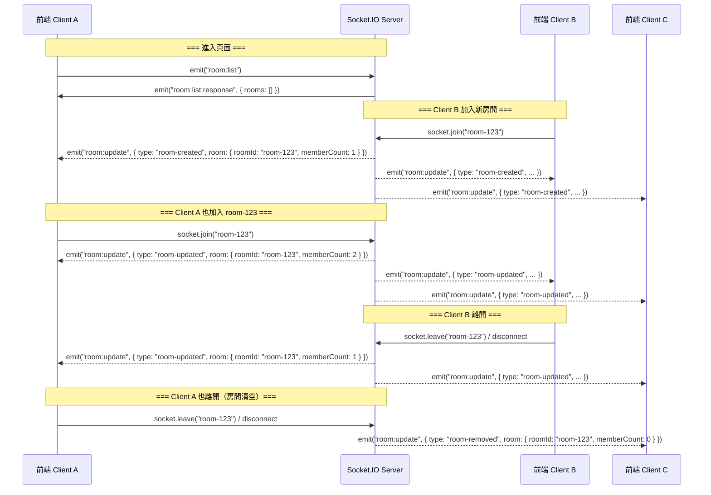

# Socket.IO 房間列表 API 規格文件

> **版本**: v1.0  
> **更新日期**: 2026-08-27  
> **對應前端**: `src/domain/broadcastVideo/hooks/useRoomList.ts`  
> **通訊協定**: Socket.IO 4.x (WebSocket / HTTP Long-polling)

---

## 1. 概述

本文件定義前端「視訊電話房間列表」功能所需的 Socket.IO 事件規格。前端透過此 API 查詢所有活躍房間清單，並即時接收房間變動通知（新建、人數變動、移除），以便在進入頁面時讓使用者一目瞭然各房間狀態。

### 1.1 既有架構

目前已建置完成的 Socket.IO 基礎架構：

| 項目 | 說明 |
|------|------|
| 連線路徑 (path) | 由前端 `VITE_WEBSOCKET` 環境變數決定 |
| 傳輸方式 | `["polling", "websocket"]` 雙軌自動升級 |
| 既有事件 | `webrtc-signaling` — WebRTC 視訊信令轉發 |

### 1.2 新增事件一覽

| 方向 | 事件名稱 | 用途 |
|------|----------|------|
| Client → Server | `room:list` | 前端請求所有活躍房間清單 |
| Server → Client | `room:list:response` | 後端回傳房間清單 |
| Server → Client | `room:update` | 後端推送房間即時變動 |

---

## 2. 資料結構定義

### 2.1 RoomInfo（單一房間資訊）

```typescript
interface RoomInfo {
  /** 房間 ID（唯一識別碼，如 "room-123"） */
  roomId: string;
  
  /** 房間內目前的成員數量 */
  memberCount: number;
  
  /** 成員 ID 清單（可選，用於進階顯示） */
  members?: string[];
}
```

### 2.2 RoomListResponse（房間列表回應）

```typescript
interface RoomListResponse {
  /** 所有活躍房間（memberCount > 0）的清單 */
  rooms: RoomInfo[];
}
```

### 2.3 RoomUpdateEvent（房間變動事件）

```typescript
interface RoomUpdateEvent {
  /** 變動類型 */
  type: "room-created" | "room-updated" | "room-removed";
  
  /** 受影響的房間資訊 */
  room: RoomInfo;
}
```

---

## 3. 事件詳細規格

### 3.1 `room:list`（Client → Server）

前端進入「視訊電話」頁面後，會 emit 此事件請求房間列表。

**Payload**: 無（不帶任何參數）

```typescript
// 前端範例
socket.emit("room:list");
```

**後端處理邏輯**:
1. 查詢所有成員數 > 0 的活躍 Socket.IO rooms
2. 過濾掉系統預設的 room（每個 socket 自動加入的 `socket.id` room）
3. 組裝 `RoomListResponse` 回傳

**回覆事件**: `room:list:response`（只回覆給發送者）

---

### 3.2 `room:list:response`（Server → Client）

後端回覆的房間清單資料。

**Payload**: `RoomListResponse`

```typescript
// 後端範例
socket.emit("room:list:response", {
  rooms: [
    { roomId: "room-123", memberCount: 2, members: ["user_abc", "user_def"] },
    { roomId: "room-456", memberCount: 1, members: ["user_ghi"] },
  ]
});
```

**注意事項**:
- 回覆只發給**請求者本人**（`socket.emit`），不廣播
- `members` 欄位為可選，後端可決定是否回傳

---

### 3.3 `room:update`（Server → Client — 廣播）

任何房間發生變動時，後端主動推送此事件給**所有已連線的 client**。

**Payload**: `RoomUpdateEvent`

#### 3.3.1 房間建立 (`room-created`)

當有使用者加入一個先前不存在的房間時觸發。

```typescript
// 後端範例：廣播給所有 client
io.emit("room:update", {
  type: "room-created",
  room: { roomId: "room-789", memberCount: 1, members: ["user_jkl"] }
});
```

#### 3.3.2 房間更新 (`room-updated`)

當房間的成員數量發生變化（新成員加入或成員離開，但房間仍有人）時觸發。

```typescript
io.emit("room:update", {
  type: "room-updated",
  room: { roomId: "room-123", memberCount: 3, members: ["user_abc", "user_def", "user_mno"] }
});
```

#### 3.3.3 房間移除 (`room-removed`)

當房間的最後一個成員離開，房間變空時觸發。

```typescript
io.emit("room:update", {
  type: "room-removed",
  room: { roomId: "room-456", memberCount: 0 }
});
```

---

## 4. 觸發時機對照表

| 使用者行為 | 後端應觸發的事件 | 廣播範圍 |
|-----------|----------------|---------|
| Client A 加入 room-123（新房間） | `room:update { type: "room-created", room: {...} }` | 所有 client (`io.emit`) |
| Client B 加入 room-123（已有人） | `room:update { type: "room-updated", room: {...} }` | 所有 client (`io.emit`) |
| Client A 離開 room-123（房間仍有人） | `room:update { type: "room-updated", room: {...} }` | 所有 client (`io.emit`) |
| Client B 離開 room-123（房間變空） | `room:update { type: "room-removed", room: {...} }` | 所有 client (`io.emit`) |
| 任何 Client emit `room:list` | `room:list:response { rooms: [...] }` | 僅請求者 (`socket.emit`) |

---

## 5. 完整流程圖



---

## 6. 後端實作建議（NestJS）

### 6.1 Gateway 範例

```typescript
import {
  WebSocketGateway,
  SubscribeMessage,
  WebSocketServer,
  OnGatewayDisconnect,
} from '@nestjs/websockets';
import { Server, Socket } from 'socket.io';

@WebSocketGateway({ cors: { origin: '*' } })
export class RoomGateway implements OnGatewayDisconnect {
  @WebSocketServer()
  server: Server;

  /**
   * 處理前端請求房間列表
   */
  @SubscribeMessage('room:list')
  handleRoomList(client: Socket): void {
    const rooms = this.getActiveRooms();
    client.emit('room:list:response', { rooms });
  }

  /**
   * 處理加入房間（可整合既有的 webrtc-signaling join 邏輯）
   */
  @SubscribeMessage('room:join')
  handleJoinRoom(client: Socket, payload: { roomId: string }): void {
    const { roomId } = payload;
    client.join(roomId);

    const room = this.getRoomInfo(roomId);
    const isNewRoom = room.memberCount === 1;

    this.server.emit('room:update', {
      type: isNewRoom ? 'room-created' : 'room-updated',
      room,
    });
  }

  /**
   * 處理離開房間
   */
  @SubscribeMessage('room:leave')
  handleLeaveRoom(client: Socket, payload: { roomId: string }): void {
    const { roomId } = payload;
    client.leave(roomId);

    const room = this.getRoomInfo(roomId);
    
    this.server.emit('room:update', {
      type: room.memberCount === 0 ? 'room-removed' : 'room-updated',
      room,
    });
  }

  /**
   * 處理斷線清理
   */
  handleDisconnect(client: Socket): void {
    // Socket.IO 會自動從所有 rooms 移除斷線 client
    // 這裡需要遍歷該 client 原本在的 rooms，發送 room:update
    const rooms = [...client.rooms].filter(r => r !== client.id);
    
    for (const roomId of rooms) {
      const room = this.getRoomInfo(roomId);
      this.server.emit('room:update', {
        type: room.memberCount === 0 ? 'room-removed' : 'room-updated',
        room,
      });
    }
  }

  /**
   * 取得所有活躍房間（排除系統自動分配的 socket.id room）
   */
  private getActiveRooms(): Array<{ roomId: string; memberCount: number; members: string[] }> {
    const rooms: Array<{ roomId: string; memberCount: number; members: string[] }> = [];
    const serverRooms = this.server.sockets.adapter.rooms;
    const socketIds = this.server.sockets.adapter.sids;

    serverRooms.forEach((sockets, roomId) => {
      // 排除 socket 自動加入的預設 room（room name === socket.id）
      if (!socketIds.has(roomId)) {
        rooms.push({
          roomId,
          memberCount: sockets.size,
          members: [...sockets],
        });
      }
    });

    return rooms;
  }

  /**
   * 取得單一房間資訊
   */
  private getRoomInfo(roomId: string): { roomId: string; memberCount: number; members: string[] } {
    const room = this.server.sockets.adapter.rooms.get(roomId);
    return {
      roomId,
      memberCount: room ? room.size : 0,
      members: room ? [...room] : [],
    };
  }
}
```

### 6.2 Module 註冊

```typescript
import { Module } from '@nestjs/common';
import { RoomGateway } from './room.gateway';

@Module({
  providers: [RoomGateway],
})
export class RoomModule {}
```

---

## 7. 錯誤處理規格

| 錯誤情境 | 後端行為 | 前端處理 |
|---------|---------|---------|
| Socket 未連線 | 不適用 | 顯示「連線中斷」提示 |
| `room:list` 查詢失敗 | emit error event 或回傳空陣列 | 顯示錯誤訊息 |
| 斷線重連 | Socket.IO 自動重連 | 重連後重新 emit `room:list` |
| 房間 ID 無效 | 由 `room:join` handler 驗證 | 前端已做基本輸入驗證 |

---

## 8. 與既有 WebRTC 信令的整合建議

目前的 `webrtc-signaling` 事件採用前端自行比對 `roomId` 的方式（Plan.md §3 描述）。建議在後端實作房間列表功能時，一併整合 Socket.IO 原生的 `socket.join(roomId)` 機制：

1. **Client 加入房間時**：除了前端監聽 `webrtc-signaling`，也呼叫後端的 `room:join` 讓 Server 記錄
2. **Client 離開房間時**：呼叫 `room:leave` 讓 Server 清理
3. **信令轉發優化**：後端可改用 `socket.to(roomId).emit(...)` 取代全域廣播，降低不必要的流量

這樣一來，前端的 `useSignaling.ts` 只需在 `joinRoom` 和 `leaveRoom` 時額外 emit 一次 `room:join` / `room:leave` 即可，信令轉發邏輯無需大幅修改。

---

## 9. 前端對應的型別定義

完整的 Zod Schema 定義位於：

📁 `src/domain/broadcastVideo/schemas/room.schema.ts`

```typescript
import { z } from "zod";

export const RoomInfoSchema = z.object({
  roomId: z.string(),
  memberCount: z.number().int().min(0),
  members: z.array(z.string()).optional(),
});

export const RoomListResponseSchema = z.object({
  rooms: z.array(RoomInfoSchema),
});

export const RoomUpdateEventSchema = z.object({
  type: z.enum(["room-created", "room-updated", "room-removed"]),
  room: RoomInfoSchema,
});

export type RoomInfo = z.infer<typeof RoomInfoSchema>;
export type RoomListResponse = z.infer<typeof RoomListResponseSchema>;
export type RoomUpdateEvent = z.infer<typeof RoomUpdateEventSchema>;
```

前端使用此 Schema 做 runtime 驗證，確保前後端資料結構一致。
