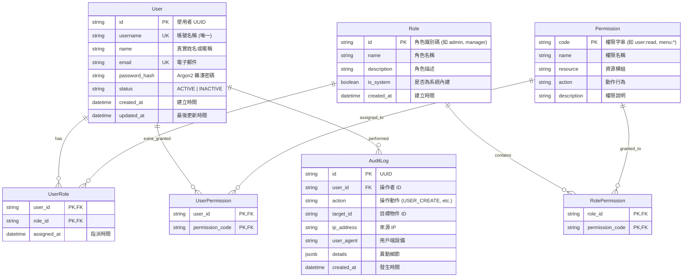

# uberMenu — 使用者與權限管理 (User Domain) 後端開發完整指南 (NestJS 10+)

> **文件版本**: 1.0.0  
> **適用框架**: NestJS 10+ / Node.js 20+ / TypeScript 5.x  
> **持久化方案**: PostgreSQL 15+ (相容 MySQL 8.0+) / Prisma ORM 或 TypeORM  
> **對應前端**: `uberMenu` 前端之 `src/domain/user` 模組、`src/stores/userstore.ts` 與 `src/services/auth.service.ts`  
> **目標對象**: 後端工程師、全端工程師、系統架構師

---

## 目錄

1. [系統總覽與模組定位](#1-系統總覽與模組定位)
2. [前後端統一通訊協議 (ApiResponse)](#2-前後端統一通訊協議-apiresponse)
3. [核心權限模型：RBAC + Resource:Action 細粒度體系](#3-核心權限模型rbac--resourceaction-細粒度體系)
4. [資料庫實體關聯 (ERD) 與 Schema 設計](#4-資料庫實體關聯-erd-與-schema-設計)
5. [RESTful API 端點詳細規格書](#5-restful-api-端點詳細規格書)
6. [認證與密碼管理 API 端點規格書](#6-認證與密碼管理-api-端點規格書)
7. [NestJS 10+ 程式碼實作範例](#7-nestjs-10-程式碼實作範例)
8. [資料庫種子資料 (Seed Data)](#8-資料庫種子資料-seed-data)
9. [安全性防護與前後端聯調防雷指南](#9-安全性防護與前後端聯調防雷指南)
10. [後端開發與驗收 Checklist](#10-後端開發與驗收-checklist)

---

## 1. 系統總覽與模組定位

### 1.1 業務背景

`uberMenu` 為一套全方位的企業級餐飲管理與動態表單系統。其中 **使用者管理 (User Domain)** 與 **存取控制 (Access Control)** 是支撐整個系統安全運作的基石。

前端 `src/domain/user` 目前已實作了完整的使用者管理介面：

- **使用者列表與搜尋篩選** (`pages/UserList.vue`)：支援依帳號、姓名、Email 模糊搜尋，角色下拉篩選、狀態切換。
- **建立與編輯彈窗** (`components/UserModal.vue`)：支援使用者帳號建立、資料修改、多角色指派、角色繼承權限即時預覽、以及自訂直屬細項權限勾選。
- **領域服務層** (`services/UserService.ts`)：透過 Axios (`apiClient`) 發送標準 RESTful 請求。
- **前端狀態管理** (`src/stores/userstore.ts`)：維護目前登入者的 Token、UserInfo、有效權限清單，並支援 `hasRole` 與 `hasPermission` 守衛。
- **密碼管理服務** (`src/services/auth.service.ts`)：處理忘記密碼發送驗證碼、驗證碼校驗與新密碼重設。

目前前端所有 API 均由 **MSW (Mock Service Worker)** 在瀏覽器端模擬。後端工程師的職責是依照本指南，以 **NestJS 10+** 開發出具備生產環境水準的 REST API 伺服器，完成系統真實持久化與授權把關。

### 1.2 前後端對接架構圖

```
[ 前端 Vue 3 + Ionic (Port 1111) ]
       │
       │ HTTP / JSON (Axios apiClient)
       │ Header: Authorization: Bearer <JWT>
       ▼
[ 反向代理 Nginx / Vite Proxy (/api) ]
       │
       ▼
[ NestJS 10+ 後端伺服器 (Port 3000) ]
       ├── GlobalPrefix: 'api'
       ├── TransformInterceptor (封裝 ApiResponse<T>)
       ├── HttpExceptionFilter (標準錯誤處理)
       ├── JwtAuthGuard (身分認證)
       ├── PermissionsGuard (細粒度 RBAC 權限比對)
       │
       ▼
[ 資料庫持久層 PostgreSQL / Prisma ]
```

---

## 2. 前後端統一通訊協議 (ApiResponse)

> [!CAUTION]
> 前端所有的 Service 層（包括 Axios Interceptor、React Query / TanStack Query）均預設解包並校驗此封裝結構。若回傳格式不一致，前端頁面會拋出未處理異常。

### 2.1 成功回應結構

```typescript
export interface ApiResponse<T> {
  success: boolean; // 固定為 true
  res_code: string; // 成功業務代碼，固定為 "111"
  message: string; // 成功提示訊息，如 "成功"、"使用者建立成功"
  ts: string; // 時間戳，格式為 "YYYYMMDDHHmm" (例如 "202608311040")
  res_body: T; // 實際資料載荷 (Payload)
}
```

### 2.2 錯誤回應結構

```typescript
export interface ApiErrorResponse {
  success: boolean; // 固定為 false
  res_code: string; // 錯誤狀態代碼，對齊 HTTP 狀態或業務代碼 (如 "400", "401", "403", "404", "409")
  message: string; // 錯誤原因描述 (前端 BaseNotification 會直接顯示此訊息)
  ts: string; // 時間戳，格式為 "YYYYMMDDHHmm"
  res_body: null; // 失敗時固定為 null
}
```

### 2.3 NestJS 全域 Interceptor 與 Filter 實作

#### (1) TransformInterceptor (`src/common/interceptors/transform.interceptor.ts`)

```typescript
import {
  CallHandler,
  ExecutionContext,
  Injectable,
  NestInterceptor,
} from '@nestjs/common';
import { Observable } from 'rxjs';
import { map } from 'rxjs/operators';
import * as dayjs from 'dayjs';

@Injectable()
export class TransformInterceptor<T> implements NestInterceptor<T, any> {
  intercept(context: ExecutionContext, next: CallHandler): Observable<any> {
    return next.handle().pipe(
      map((data) => {
        // 若 Controller 回傳之內容已自行封裝 ApiResponse，則直接返回
        if (
          data &&
          typeof data === 'object' &&
          'res_code' in data &&
          'res_body' in data
        ) {
          return data;
        }

        return {
          success: true,
          res_code: '111',
          message: '成功',
          ts: dayjs().format('YYYYMMDDHHmm'),
          res_body: data ?? null,
        };
      }),
    );
  }
}
```

#### (2) HttpExceptionFilter (`src/common/filters/http-exception.filter.ts`)

```typescript
import {
  ExceptionFilter,
  Catch,
  ArgumentsHost,
  HttpException,
  HttpStatus,
} from '@nestjs/common';
import { Response } from 'express';
import * as dayjs from 'dayjs';

@Catch()
export class HttpExceptionFilter implements ExceptionFilter {
  catch(exception: unknown, host: ArgumentsHost) {
    const ctx = host.switchToHttp();
    const response = ctx.getResponse<Response>();

    let status = HttpStatus.INTERNAL_SERVER_ERROR;
    let message = '伺服器發生非預期錯誤，請稍後再試';

    if (exception instanceof HttpException) {
      status = exception.getStatus();
      const res = exception.getResponse();
      if (typeof res === 'string') {
        message = res;
      } else if (typeof res === 'object' && res !== null) {
        const anyRes = res as any;
        message = Array.isArray(anyRes.message)
          ? anyRes.message.join(', ')
          : anyRes.message || exception.message;
      }
    } else if (exception instanceof Error) {
      message = exception.message;
    }

    response.status(status).json({
      success: false,
      res_code: String(status),
      message,
      ts: dayjs().format('YYYYMMDDHHmm'),
      res_body: null,
    });
  }
}
```

---

## 3. 核心權限模型：RBAC + Resource:Action 細粒度體系

### 3.1 權限分層架構

本系統結合了 **RBAC (Role-Based Access Control)** 與 **細粒度 Resource:Action 權限模型**：

1. **多角色機制**：使用者可指派多個角色（例如：`['manager', 'staff']`）。
2. **角色繼承權限**：每個角色預設定義了一組細項權限集合（Permissions）。
3. **使用者直屬權限 (Direct User Permissions)**：允許在不更動角色的情況下，為特定帳號單獨追加權限（例如：一般店員額外被賦予 `menu:write`）。
4. **有效權限計算 (Effective Permissions)**：
   $$\text{Effective Permissions} = \left( \bigcup_{r \in \text{User.roles}} \text{RolePermissions}(r) \right) \cup \text{User.directPermissions}$$

### 3.2 權限代碼清單 (對齊前端 `PERMISSIONS` 定義)

| 模組資源       | 權限代碼                 | 說明                                     |
| -------------- | ------------------------ | ---------------------------------------- |
| **全域**       | `*`                      | 超級管理員萬用權限（放行所有操作）       |
| **使用者管理** | `user:*`                 | 使用者模組完整控制權                     |
|                | `user:read`              | 檢視使用者清單與詳情、檢視角色與權限字典 |
|                | `user:write`             | 建立新使用者、更新既有使用者             |
|                | `user:delete`            | 刪除使用者                               |
| **菜單管理**   | `menu:*`                 | 菜單模組完整控制權                       |
|                | `menu:read`              | 瀏覽菜單品項、分類與修飾組               |
|                | `menu:write`             | 新增、修改菜單與品項資料                 |
|                | `menu:delete`            | 刪除菜單品項或分類                       |
| **動態表單**   | `dynamicForm:*`          | 動態表單完整控制權                       |
|                | `dynamicForm:read`       | 檢視與填寫動態表單                       |
|                | `dynamicForm:write`      | 建立與設計動態表單結構 (Form Builder)    |
|                | `dynamicForm:delete`     | 刪除動態表單                             |
| **視訊通話**   | `broadcastVideo:*`       | 視訊通話完整控制權                       |
|                | `broadcastVideo:join`    | 加入視訊房間通話                         |
|                | `broadcastVideo:manage`  | 管理與踢除通話成員、建立/關閉房間        |
| **預算管理**   | `budget:*`               | 預算模組完整控制權                       |
|                | `budget:read`            | 檢視預算列表與詳情                       |
|                | `budget:write`           | 建立、修改或刪除預算條目                 |
| **專案時程**   | `projectScheduler:*`     | 專案時程模組完整控制權                   |
|                | `projectScheduler:read`  | 檢視甘特圖與排程                         |
|                | `projectScheduler:write` | 建立、修改、拖曳任務時程                 |

### 3.3 萬用字元匹配演算法 (Wildcard Matching Algorithm)

後端守衛在比對請求所需權限與使用者持有權限時，必須嚴格實現以下規則：

1. 若擁有 `*`，一律放行。
2. 若完全匹配（如 `user:read` === `user:read`），放行。
3. 命名空間匹配：以冒號 `:` 分割。例如持有 `user:*` 可匹配 `user:read`、`user:write`、`user:delete`。
4. 階層長度比對：`module:resource:*` 可匹配 `module:resource:action`。

```typescript
/**
 * 萬用字元與階層細項權限匹配演算法
 * @param userPermissions 使用者當前擁有的有效權限清單
 * @param requiredPermission 目標 API 端點所要求的權限字串
 */
export function matchPermission(
  userPermissions: string[],
  requiredPermission: string,
): boolean {
  if (!userPermissions || userPermissions.length === 0) return false;
  if (!requiredPermission) return true;

  // 1. 全域超級管理員直接放行
  if (userPermissions.includes('*')) return true;

  // 2. 完全匹配
  if (userPermissions.includes(requiredPermission)) return true;

  // 3. 萬用字元階層匹配
  const requiredParts = requiredPermission.split(':');

  return userPermissions.some((perm) => {
    if (perm === '*') return true;
    if (!perm.includes('*')) return perm === requiredPermission;

    const permParts = perm.split(':');
    for (let i = 0; i < permParts.length; i++) {
      if (permParts[i] === '*') return true; // 後續全放行
      if (permParts[i] !== requiredParts[i]) return false;
    }
    return permParts.length === requiredParts.length;
  });
}
```

---

## 4. 資料庫實體關聯 (ERD) 與 Schema 設計

### 4.1 Mermaid 實體關聯圖 (ERD)



### 4.2 標準 PostgreSQL DDL 建表語法

```sql
-- 啟用 UUID 擴展
CREATE EXTENSION IF NOT EXISTS "uuid-ossp";

-- 1. 使用者主表
CREATE TYPE user_status_enum AS ENUM ('ACTIVE', 'INACTIVE');

CREATE TABLE users (
    id VARCHAR(64) PRIMARY KEY DEFAULT uuid_generate_v4()::text,
    username VARCHAR(50) NOT NULL UNIQUE,
    name VARCHAR(100) NOT NULL,
    email VARCHAR(255) NOT NULL,
    password_hash VARCHAR(255) NOT NULL,
    status user_status_enum NOT NULL DEFAULT 'ACTIVE',
    created_at TIMESTAMP WITH TIME ZONE NOT NULL DEFAULT CURRENT_TIMESTAMP,
    updated_at TIMESTAMP WITH TIME ZONE NOT NULL DEFAULT CURRENT_TIMESTAMP
);

CREATE INDEX idx_users_username ON users(username);
CREATE INDEX idx_users_email ON users(email);
CREATE INDEX idx_users_status ON users(status);

-- 2. 角色表
CREATE TABLE roles (
    id VARCHAR(50) PRIMARY KEY,
    name VARCHAR(100) NOT NULL,
    description TEXT,
    is_system BOOLEAN NOT NULL DEFAULT false,
    created_at TIMESTAMP WITH TIME ZONE NOT NULL DEFAULT CURRENT_TIMESTAMP
);

-- 3. 權限定義表
CREATE TABLE permissions (
    code VARCHAR(100) PRIMARY KEY,
    name VARCHAR(100) NOT NULL,
    resource VARCHAR(50) NOT NULL,
    action VARCHAR(50) NOT NULL,
    description TEXT
);

CREATE INDEX idx_permissions_resource ON permissions(resource);

-- 4. 使用者與角色多對多關聯表
CREATE TABLE user_roles (
    user_id VARCHAR(64) NOT NULL REFERENCES users(id) ON DELETE CASCADE,
    role_id VARCHAR(50) NOT NULL REFERENCES roles(id) ON DELETE CASCADE,
    assigned_at TIMESTAMP WITH TIME ZONE NOT NULL DEFAULT CURRENT_TIMESTAMP,
    PRIMARY KEY (user_id, role_id)
);

-- 5. 角色與權限多對多關聯表
CREATE TABLE role_permissions (
    role_id VARCHAR(50) NOT NULL REFERENCES roles(id) ON DELETE CASCADE,
    permission_code VARCHAR(100) NOT NULL REFERENCES permissions(code) ON DELETE CASCADE,
    PRIMARY KEY (role_id, permission_code)
);

-- 6. 使用者直屬額外權限表
CREATE TABLE user_permissions (
    user_id VARCHAR(64) NOT NULL REFERENCES users(id) ON DELETE CASCADE,
    permission_code VARCHAR(100) NOT NULL REFERENCES permissions(code) ON DELETE CASCADE,
    PRIMARY KEY (user_id, permission_code)
);

-- 7. 審計日誌表 (Audit Log)
CREATE TABLE audit_logs (
    id VARCHAR(64) PRIMARY KEY DEFAULT uuid_generate_v4()::text,
    user_id VARCHAR(64),
    action VARCHAR(100) NOT NULL,
    target_id VARCHAR(64),
    ip_address VARCHAR(50),
    user_agent TEXT,
    details JSONB,
    created_at TIMESTAMP WITH TIME ZONE NOT NULL DEFAULT CURRENT_TIMESTAMP
);

CREATE INDEX idx_audit_logs_user_action ON audit_logs(user_id, action);
CREATE INDEX idx_audit_logs_created_at ON audit_logs(created_at DESC);
```

### 4.3 Prisma Schema 定義

```prisma
datasource db {
  provider = "postgresql"
  url      = env("DATABASE_URL")
}

generator client {
  provider = "prisma-client-js"
}

enum UserStatus {
  ACTIVE
  INACTIVE
}

model User {
  id           String           @id @default(uuid())
  username     String           @unique @db.VarChar(50)
  name         String           @db.VarChar(100)
  email        String           @db.VarChar(255)
  passwordHash String           @map("password_hash") @db.VarChar(255)
  status       UserStatus       @default(ACTIVE)
  roles        UserRole[]
  permissions  UserPermission[]
  createdAt    DateTime         @default(now()) @map("created_at")
  updatedAt    DateTime         @updatedAt @map("updated_at")

  @@map("users")
}

model Role {
  id          String           @id @db.VarChar(50)
  name        String           @db.VarChar(100)
  description String?          @db.Text
  isSystem    Boolean          @default(false) @map("is_system")
  users       UserRole[]
  permissions RolePermission[]
  createdAt   DateTime         @default(now()) @map("created_at")

  @@map("roles")
}

model Permission {
  code        String           @id @db.VarChar(100)
  name        String           @db.VarChar(100)
  resource    String           @db.VarChar(50)
  action      String           @db.VarChar(50)
  description String?          @db.Text
  roles       RolePermission[]
  users       UserPermission[]

  @@map("permissions")
}

model UserRole {
  userId     String   @map("user_id")
  roleId     String   @map("role_id")
  assignedAt DateTime @default(now()) @map("assigned_at")

  user User @relation(fields: [userId], references: [id], onDelete: Cascade)
  role Role @relation(fields: [roleId], references: [id], onDelete: Cascade)

  @@id([userId, roleId])
  @@map("user_roles")
}

model RolePermission {
  roleId         String     @map("role_id")
  permissionCode String     @map("permission_code")
  role           Role       @relation(fields: [roleId], references: [id], onDelete: Cascade)
  permission     Permission @relation(fields: [permissionCode], references: [code], onDelete: Cascade)

  @@id([roleId, permissionCode])
  @@map("role_permissions")
}

model UserPermission {
  userId         String     @map("user_id")
  permissionCode String     @map("permission_code")
  user           User       @relation(fields: [userId], references: [id], onDelete: Cascade)
  permission     Permission @relation(fields: [permissionCode], references: [code], onDelete: Cascade)

  @@id([userId, permissionCode])
  @@map("user_permissions")
}

model AuditLog {
  id        String   @id @default(uuid())
  userId    String?  @map("user_id")
  action    String   @db.VarChar(100)
  targetId  String?  @map("target_id")
  ipAddress String?  @map("ip_address") @db.VarChar(50)
  userAgent String?  @map("user_agent") @db.Text
  details   Json?    @db.JsonB
  createdAt DateTime @default(now()) @map("created_at")

  @@index([userId, action])
  @@map("audit_logs")
}
```

---

## 5. RESTful API 端點詳細規格書

### 5.1 端點總覽

| 方法  | 路徑             | 權限需求    | 說明                                       |
| ----- | ---------------- | ----------- | ------------------------------------------ |
| `GET` | `/api/users`     | `user:read` | 查詢使用者列表（支援搜尋、角色與狀態篩選） |
| `GET` | `/api/users/:id` | `user:read` | 取得單一使用者詳細資訊                     |

| `POST` | `/api/users` | `user:write` | 建立新使用者帳號 |
| `PUT` | `/api/users/:id` | `user:write` | 更新既有使用者資料 |
| `DELETE` | `/api/users/:id` | `user:delete` | 刪除指定使用者 |
| `GET` | `/api/roles` | `user:read` | 取得系統所有可用角色定義與其預設權限 |
| `GET` | `/api/permissions` | `user:read` | 取得系統所有可用細項權限字典清單 |

---

### 5.2 端點規格詳述

#### 1. 取得使用者列表

- **HTTP Method**: `GET`
- **路徑**: `/api/users`
- **權限**: `@RequirePermissions('user:read')`
- **Query 參數**:
  - `search` (string, 選填): 依 `username`、`name` 或 `email` 模糊搜尋
  - `role` (string, 選填): 依角色代碼篩選（如 `admin`, `manager`, `staff`, `viewer`）
  - `status` (string, 選填): 依狀態篩選（`ACTIVE` 或 `INACTIVE`）
  - `page` (number, 選填, 預設 1)
  - `limit` (number, 選填, 預設 20)

**成功回應 (200 OK)**:

```json
{
  "success": true,
  "res_code": "111",
  "message": "成功",
  "ts": "202608311045",
  "res_body": [
    {
      "id": "user_admin",
      "username": "admin",
      "name": "系統超級管理員",
      "email": "admin@ubermenu.com",
      "roles": ["admin"],
      "permissions": ["*"],
      "status": "ACTIVE",
      "createdAt": "2026-08-01 10:00:00",
      "updatedAt": "2026-08-01 10:00:00"
    },
    {
      "id": "user_manager",
      "username": "manager_chen",
      "name": "陳店長",
      "email": "chen@ubermenu.com",
      "roles": ["manager"],
      "permissions": [],
      "status": "ACTIVE",
      "createdAt": "2026-08-10 14:30:00",
      "updatedAt": "2026-08-15 11:20:00"
    }
  ]
}
```

---

#### 2. 取得單一使用者詳細資訊

- **HTTP Method**: `GET`
- **路徑**: `/api/users/:id`
- **權限**: `@RequirePermissions('user:read')`
- **URL 參數**: `id` (使用者 ID)

**成功回應 (200 OK)**:

```json
{
  "success": true,
  "res_code": "111",
  "message": "成功",
  "ts": "202608311045",
  "res_body": {
    "id": "user_manager",
    "username": "manager_chen",
    "name": "陳店長",
    "email": "chen@ubermenu.com",
    "roles": ["manager"],
    "permissions": [],
    "status": "ACTIVE",
    "createdAt": "2026-08-10 14:30:00",
    "updatedAt": "2026-08-15 11:20:00"
  }
}
```

**失敗回應 (404 Not Found)**:

```json
{
  "success": false,
  "res_code": "404",
  "message": "找不到指定 ID 的使用者",
  "ts": "202608311045",
  "res_body": null
}
```

---

#### 3. 建立新使用者

- **HTTP Method**: `POST`
- **路徑**: `/api/users`
- **權限**: `@RequirePermissions('user:write')`
- **Request Body (`application/json`)**:

```json
{
  "username": "alex_chen",
  "name": "陳小明",
  "email": "alex@ubermenu.com",
  "password": "SecurePassword123!",
  "roles": ["staff"],
  "permissions": ["menu:write"],
  "status": "ACTIVE"
}
```

| 欄位          | 型別     | 必填 | 驗證約束                                 |
| ------------- | -------- | ---- | ---------------------------------------- |
| `username`    | string   | 是   | 長度 3~50 字元，不可與現有帳號重複       |
| `name`        | string   | 是   | 長度 1~100 字元                          |
| `email`       | string   | 否   | 若提供必須為合法 Email 格式              |
| `password`    | string   | 否   | 預設密碼，若未提供後端應自動生成臨時密碼 |
| `roles`       | string[] | 是   | 陣列至少需包含 1 個合法角色 ID           |
| `permissions` | string[] | 否   | 直屬自訂細項權限字串陣列，預設 `[]`      |
| `status`      | string   | 否   | `ACTIVE` 或 `INACTIVE`，預設 `ACTIVE`    |

**成功回應 (201 Created)**:

```json
{
  "success": true,
  "res_code": "111",
  "message": "使用者建立成功",
  "ts": "202608311046",
  "res_body": {
    "id": "c1787817-6401-447b-8395-6b589f816401",
    "username": "alex_chen",
    "name": "陳小明",
    "email": "alex@ubermenu.com",
    "roles": ["staff"],
    "permissions": ["menu:write"],
    "status": "ACTIVE",
    "createdAt": "2026-08-31 10:46:00",
    "updatedAt": "2026-08-31 10:46:00"
  }
}
```

**帳號重複衝突 (409 Conflict)**:

```json
{
  "success": false,
  "res_code": "409",
  "message": "該使用者帳號已存在，請使用不同帳號",
  "ts": "202608311046",
  "res_body": null
}
```

---

#### 4. 更新既有使用者

- **HTTP Method**: `PUT`
- **路徑**: `/api/users/:id`
- **權限**: `@RequirePermissions('user:write')`
- **URL 參數**: `id` (使用者 ID)
- **Request Body (`application/json`)**:

```json
{
  "name": "陳小明 (已更名)",
  "email": "alex.new@ubermenu.com",
  "roles": ["manager"],
  "permissions": ["menu:write", "broadcastVideo:manage"],
  "status": "ACTIVE",
  "password": "NewPassword456!"
}
```

> [!NOTE]
> `username` 在建立後不得隨意變更。若 `password` 傳入空字串或未提供，後端應保留原本的密碼雜湊，不得覆寫為空。

**成功回應 (200 OK)**:

```json
{
  "success": true,
  "res_code": "111",
  "message": "使用者更新成功",
  "ts": "202608311047",
  "res_body": {
    "id": "user_102",
    "username": "alex_chen",
    "name": "陳小明 (已更名)",
    "email": "alex.new@ubermenu.com",
    "roles": ["manager"],
    "permissions": ["menu:write", "broadcastVideo:manage"],
    "status": "ACTIVE",
    "createdAt": "2026-08-31 10:46:00",
    "updatedAt": "2026-08-31 10:47:00"
  }
}
```

---

#### 5. 刪除使用者

- **HTTP Method**: `DELETE`
- **路徑**: `/api/users/:id`
- **權限**: `@RequirePermissions('user:delete')`
- **URL 參數**: `id` (使用者 ID)

> [!CAUTION]
> **安全性保護**：後端必須阻擋刪除當前登入者自身帳號，以及系統內建之 `admin` 超級管理員帳號。

**成功回應 (200 OK)**:

```json
{
  "success": true,
  "res_code": "111",
  "message": "使用者已成功刪除",
  "ts": "202608311048",
  "res_body": null
}
```

---

#### 6. 取得系統角色清單

- **HTTP Method**: `GET`
- **路徑**: `/api/roles`
- **權限**: `@RequirePermissions('user:read')`

**成功回應 (200 OK)**:

```json
{
  "success": true,
  "res_code": "111",
  "message": "成功",
  "ts": "202608311048",
  "res_body": [
    {
      "id": "admin",
      "name": "系統超級管理員",
      "description": "擁有系統所有模組之最高完整存取與異動權限",
      "permissions": ["*"]
    },
    {
      "id": "manager",
      "name": "營運經理",
      "description": "可管理菜單、動態表單與專案時程，具備使用者檢視權限",
      "permissions": [
        "user:read",
        "menu:*",
        "dynamicForm:*",
        "broadcastVideo:join",
        "projectScheduler:*",
        "budget:*"
      ]
    },
    {
      "id": "staff",
      "name": "門市店員",
      "description": "可操作菜單點餐與填寫動態表單，加入視訊通話",
      "permissions": ["menu:read", "dynamicForm:read", "broadcastVideo:join"]
    },
    {
      "id": "viewer",
      "name": "外部訪客",
      "description": "僅具備首頁與公開資訊瀏覽權限",
      "permissions": []
    }
  ]
}
```

---

#### 7. 取得所有細項權限字典清單

- **HTTP Method**: `GET`
- **路徑**: `/api/permissions`
- **權限**: `@RequirePermissions('user:read')`

**成功回應 (200 OK)**:

```json
{
  "success": true,
  "res_code": "111",
  "message": "成功",
  "ts": "202608311048",
  "res_body": [
    "*",
    "user:*",
    "user:read",
    "user:write",
    "user:delete",
    "menu:*",
    "menu:read",
    "menu:write",
    "menu:delete",
    "dynamicForm:*",
    "dynamicForm:read",
    "dynamicForm:write",
    "dynamicForm:delete",
    "broadcastVideo:*",
    "broadcastVideo:join",
    "broadcastVideo:manage",
    "budget:*",
    "budget:read",
    "budget:write",
    "projectScheduler:*",
    "projectScheduler:read",
    "projectScheduler:write"
  ]
}
```

---

## 6. 認證與密碼管理 API 端點規格書

為支援前端 `useUserStore` 與 `AuthService.ts`（包含登入、取得當前資訊、忘記密碼與重設密碼流程），後端需提供以下 `/api/auth` 介面：

### 6.1 帳號密碼登入

- **HTTP Method**: `POST`
- **路徑**: `/api/auth/login`
- **Request Body**:

```json
{
  "username": "admin",
  "password": "AdminPassword123!"
}
```

**成功回應 (200 OK)**:

```json
{
  "success": true,
  "res_code": "111",
  "message": "登入成功",
  "ts": "202608311050",
  "res_body": {
    "token": "eyJhbGciOiJIUzI1NiIsInR5cCI6IkpXVCJ9...",
    "user": {
      "id": "user_admin",
      "username": "admin",
      "name": "系統超級管理員",
      "email": "admin@ubermenu.com",
      "roles": ["admin"]
    },
    "permissions": ["*"]
  }
}
```

### 6.2 取得當前登入者資訊

- **HTTP Method**: `GET`
- **路徑**: `/api/auth/me`
- **Header**: `Authorization: Bearer <token>`

**成功回應 (200 OK)**:

```json
{
  "success": true,
  "res_code": "111",
  "message": "成功",
  "ts": "202608311050",
  "res_body": {
    "user": {
      "id": "user_admin",
      "username": "admin",
      "name": "系統超級管理員",
      "email": "admin@ubermenu.com",
      "roles": ["admin"]
    },
    "permissions": ["*"]
  }
}
```

### 6.3 發送忘記密碼驗證碼 (OTP)

- **HTTP Method**: `POST`
- **路徑**: `/api/auth/forgot-password`
- **Request Body**:

```json
{
  "email": "alex@ubermenu.com"
}
```

**成功回應 (200 OK)**:

```json
{
  "success": true,
  "res_code": "111",
  "message": "驗證碼已成功寄送至您的電子信箱",
  "ts": "202608311051",
  "res_body": {
    "expireSeconds": 300
  }
}
```

### 6.4 驗證重設驗證碼

- **HTTP Method**: `POST`
- **路徑**: `/api/auth/verify-reset-code`
- **Request Body**:

```json
{
  "email": "alex@ubermenu.com",
  "code": "859201"
}
```

**成功回應 (200 OK)**:

```json
{
  "success": true,
  "res_code": "111",
  "message": "驗證碼正確",
  "ts": "202608311052",
  "res_body": {
    "valid": true
  }
}
```

### 6.5 執行重設新密碼

- **HTTP Method**: `POST`
- **路徑**: `/api/auth/reset-password`
- **Request Body**:

```json
{
  "email": "alex@ubermenu.com",
  "code": "859201",
  "newPassword": "NewSecurePassword789!"
}
```

**成功回應 (200 OK)**:

```json
{
  "success": true,
  "res_code": "111",
  "message": "密碼重設成功，請重新登入",
  "ts": "202608311053",
  "res_body": {
    "reset": true
  }
}
```

---

## 7. NestJS 10+ 程式碼實作範例

### 7.1 DTO 宣告 (`src/modules/user/dto/user.dto.ts`)

```typescript
import {
  IsString,
  IsNotEmpty,
  IsEmail,
  IsArray,
  IsEnum,
  IsOptional,
  MinLength,
  MaxLength,
} from 'class-validator';

export enum UserStatusDto {
  ACTIVE = 'ACTIVE',
  INACTIVE = 'INACTIVE',
}

export class CreateUserDto {
  @IsString()
  @IsNotEmpty({ message: '帳號不可為空' })
  @MinLength(3, { message: '帳號長度至少需 3 個字元' })
  @MaxLength(50, { message: '帳號長度上限為 50 個字元' })
  username: string;

  @IsString()
  @IsNotEmpty({ message: '姓名不可為空' })
  @MaxLength(100, { message: '姓名上限為 100 個字元' })
  name: string;

  @IsOptional()
  @IsEmail({}, { message: '請輸入有效的電子郵件格式' })
  email?: string;

  @IsOptional()
  @IsString()
  @MinLength(6, { message: '密碼長度至少需 6 個字元' })
  password?: string;

  @IsArray({ message: '角色必須為陣列清單' })
  @IsString({ each: true })
  @IsNotEmpty({ message: '請至少指派一個系統角色' })
  roles: string[];

  @IsOptional()
  @IsArray()
  @IsString({ each: true })
  permissions?: string[];

  @IsOptional()
  @IsEnum(UserStatusDto, { message: '狀態必須為 ACTIVE 或 INACTIVE' })
  status?: UserStatusDto;
}

export class UpdateUserDto {
  @IsOptional()
  @IsString()
  @MinLength(1, { message: '姓名不可為空' })
  @MaxLength(100)
  name?: string;

  @IsOptional()
  @IsEmail({}, { message: '請輸入有效的電子郵件格式' })
  email?: string;

  @IsOptional()
  @IsString()
  @MinLength(6, { message: '密碼長度至少需 6 個字元' })
  password?: string;

  @IsOptional()
  @IsArray()
  @IsString({ each: true })
  roles?: string[];

  @IsOptional()
  @IsArray()
  @IsString({ each: true })
  permissions?: string[];

  @IsOptional()
  @IsEnum(UserStatusDto)
  status?: UserStatusDto;
}

export class QueryUserDto {
  @IsOptional()
  @IsString()
  search?: string;

  @IsOptional()
  @IsString()
  role?: string;

  @IsOptional()
  @IsEnum(UserStatusDto)
  status?: UserStatusDto;
}
```

### 7.2 自訂裝飾器與權限守衛 (`src/common/guards/permissions.guard.ts`)

```typescript
import {
  SetMetadata,
  Injectable,
  CanActivate,
  ExecutionContext,
  ForbiddenException,
} from '@nestjs/common';
import { Reflector } from '@nestjs/core';
import { matchPermission } from '../utils/permission.util';

export const PERMISSIONS_KEY = 'permissions';
export const RequirePermissions = (...permissions: string[]) =>
  SetMetadata(PERMISSIONS_KEY, permissions);

@Injectable()
export class PermissionsGuard implements CanActivate {
  constructor(private reflector: Reflector) {}

  canActivate(context: ExecutionContext): boolean {
    const requiredPermissions = this.reflector.getAllAndOverride<string[]>(
      PERMISSIONS_KEY,
      [context.getHandler(), context.getClass()],
    );

    // 若端點未要求特定權限，則放行
    if (!requiredPermissions || requiredPermissions.length === 0) {
      return true;
    }

    const request = context.switchToHttp().getRequest();
    const user = request.user; // 由 JwtAuthGuard 解析附加於 request.user

    if (!user) {
      throw new ForbiddenException('未通過身分驗證，無法判定存取權限');
    }

    // 計算使用者持有的所有有效權限 (Effective Permissions)
    const userPermissions: string[] = user.permissions || [];

    const hasPermission = requiredPermissions.some((required) =>
      matchPermission(userPermissions, required),
    );

    if (!hasPermission) {
      throw new ForbiddenException(
        `權限不足：需要具備 [${requiredPermissions.join(', ')}] 權限`,
      );
    }

    return true;
  }
}
```

### 7.3 Controller 實作 (`src/modules/user/user.controller.ts`)

```typescript
import {
  Controller,
  Get,
  Post,
  Put,
  Delete,
  Param,
  Body,
  Query,
  UseGuards,
  HttpCode,
  HttpStatus,
} from '@nestjs/common';
import { UserService } from './user.service';
import { CreateUserDto, UpdateUserDto, QueryUserDto } from './dto/user.dto';
import { JwtAuthGuard } from '../../common/guards/jwt-auth.guard';
import {
  PermissionsGuard,
  RequirePermissions,
} from '../../common/guards/permissions.guard';

@Controller('users')
@UseGuards(JwtAuthGuard, PermissionsGuard)
export class UserController {
  constructor(private readonly userService: UserService) {}

  @Get()
  @RequirePermissions('user:read')
  async findAll(@Query() query: QueryUserDto) {
    const users = await this.userService.findAll(query);
    return users;
  }

  @Get(':id')
  @RequirePermissions('user:read')
  async findOne(@Param('id') id: string) {
    const user = await this.userService.findOne(id);
    return user;
  }

  @Post()
  @HttpCode(HttpStatus.CREATED)
  @RequirePermissions('user:write')
  async create(@Body() dto: CreateUserDto) {
    const newUser = await this.userService.create(dto);
    return newUser;
  }

  @Put(':id')
  @RequirePermissions('user:write')
  async update(@Param('id') id: string, @Body() dto: UpdateUserDto) {
    const updated = await this.userService.update(id, dto);
    return updated;
  }

  @Delete(':id')
  @RequirePermissions('user:delete')
  async remove(@Param('id') id: string) {
    await this.userService.remove(id);
    return null;
  }
}
```

### 7.4 字典 Controller (`src/modules/user/meta.controller.ts`)

```typescript
import { Controller, Get, UseGuards } from '@nestjs/common';
import { UserService } from './user.service';
import { JwtAuthGuard } from '../../common/guards/jwt-auth.guard';
import {
  PermissionsGuard,
  RequirePermissions,
} from '../../common/guards/permissions.guard';

@Controller()
@UseGuards(JwtAuthGuard, PermissionsGuard)
export class MetaController {
  constructor(private readonly userService: UserService) {}

  @Get('roles')
  @RequirePermissions('user:read')
  async getRoles() {
    return this.userService.getRoles();
  }

  @Get('permissions')
  @RequirePermissions('user:read')
  async getPermissions() {
    return this.userService.getPermissions();
  }
}
```

### 7.5 Service 實作 (`src/modules/user/user.service.ts`)

```typescript
import {
  Injectable,
  NotFoundException,
  ConflictException,
  BadRequestException,
} from '@nestjs/common';
import { PrismaService } from '../../prisma/prisma.service';
import { CreateUserDto, UpdateUserDto, QueryUserDto } from './dto/user.dto';
import * as argon2 from 'argon2';

@Injectable()
export class UserService {
  constructor(private readonly prisma: PrismaService) {}

  /**
   * 查詢使用者清單
   */
  async findAll(query: QueryUserDto) {
    const { search, role, status } = query;

    const where: any = {};

    if (search) {
      where.OR = [
        { username: { contains: search, mode: 'insensitive' } },
        { name: { contains: search, mode: 'insensitive' } },
        { email: { contains: search, mode: 'insensitive' } },
      ];
    }

    if (status) {
      where.status = status;
    }

    if (role) {
      where.roles = {
        some: { roleId: role },
      };
    }

    const users = await this.prisma.user.findMany({
      where,
      include: {
        roles: true,
        permissions: true,
      },
      orderBy: { createdAt: 'desc' },
    });

    return users.map(this.transformUserResponse);
  }

  /**
   * 查詢單一使用者
   */
  async findOne(id: string) {
    const user = await this.prisma.user.findUnique({
      where: { id },
      include: {
        roles: true,
        permissions: true,
      },
    });

    if (!user) {
      throw new NotFoundException(`找不到 ID 為 ${id} 的使用者`);
    }

    return this.transformUserResponse(user);
  }

  /**
   * 建立使用者
   */
  async create(dto: CreateUserDto) {
    // 1. 檢查帳號是否重複
    const existing = await this.prisma.user.findUnique({
      where: { username: dto.username },
    });

    if (existing) {
      throw new ConflictException('該使用者帳號已存在，請使用不同帳號');
    }

    // 2. 雜湊密碼
    const passwordToHash = dto.password || 'UberMenu2026!';
    const passwordHash = await argon2.hash(passwordToHash);

    // 3. 建立使用者與關聯
    const created = await this.prisma.user.create({
      data: {
        username: dto.username,
        name: dto.name,
        email: dto.email || `${dto.username}@ubermenu.com`,
        passwordHash,
        status: (dto.status as any) || 'ACTIVE',
        roles: {
          create: dto.roles.map((roleId) => ({ roleId })),
        },
        permissions: {
          create: (dto.permissions || []).map((permissionCode) => ({
            permissionCode,
          })),
        },
      },
      include: {
        roles: true,
        permissions: true,
      },
    });

    return this.transformUserResponse(created);
  }

  /**
   * 更新使用者
   */
  async update(id: string, dto: UpdateUserDto) {
    const user = await this.prisma.user.findUnique({ where: { id } });
    if (!user) {
      throw new NotFoundException(`找不到 ID 為 ${id} 的使用者`);
    }

    const updateData: any = {};
    if (dto.name) updateData.name = dto.name;
    if (dto.email !== undefined) updateData.email = dto.email;
    if (dto.status) updateData.status = dto.status;
    if (dto.password && dto.password.trim().length >= 6) {
      updateData.passwordHash = await argon2.hash(dto.password);
    }

    // 交易更新關聯角色與直屬權限
    const updated = await this.prisma.$transaction(async (tx) => {
      if (dto.roles) {
        await tx.userRole.deleteMany({ where: { userId: id } });
        await tx.userRole.createMany({
          data: dto.roles.map((roleId) => ({ userId: id, roleId })),
        });
      }

      if (dto.permissions) {
        await tx.userPermission.deleteMany({ where: { userId: id } });
        await tx.userPermission.createMany({
          data: dto.permissions.map((permissionCode) => ({
            userId: id,
            permissionCode,
          })),
        });
      }

      return tx.user.update({
        where: { id },
        data: updateData,
        include: {
          roles: true,
          permissions: true,
        },
      });
    });

    return this.transformUserResponse(updated);
  }

  /**
   * 刪除使用者
   */
  async remove(id: string) {
    const user = await this.prisma.user.findUnique({ where: { id } });
    if (!user) {
      throw new NotFoundException(`找不到欲刪除的使用者`);
    }

    if (user.username === 'admin') {
      throw new BadRequestException('系統管理員帳號不可被刪除');
    }

    await this.prisma.user.delete({ where: { id } });
  }

  /**
   * 取得所有角色
   */
  async getRoles() {
    const roles = await this.prisma.role.findMany({
      include: {
        permissions: true,
      },
    });

    return roles.map((r) => ({
      id: r.id,
      name: r.name,
      description: r.description,
      permissions: r.permissions.map((p) => p.permissionCode),
    }));
  }

  /**
   * 取得所有權限字串清單
   */
  async getPermissions() {
    const permissions = await this.prisma.permission.findMany();
    return permissions.map((p) => p.code);
  }

  /**
   * 將 DB 模型轉換為前端期望的 User 結構
   */
  private transformUserResponse(user: any) {
    return {
      id: user.id,
      username: user.username,
      name: user.name,
      email: user.email,
      roles: user.roles?.map((r: any) => r.roleId) || [],
      permissions: user.permissions?.map((p: any) => p.permissionCode) || [],
      status: user.status,
      createdAt:
        user.createdAt instanceof Date
          ? user.createdAt.toISOString().replace('T', ' ').substring(0, 19)
          : user.createdAt,
      updatedAt:
        user.updatedAt instanceof Date
          ? user.updatedAt.toISOString().replace('T', ' ').substring(0, 19)
          : user.updatedAt,
    };
  }
}
```

---

## 8. 資料庫種子資料 (Seed Data)

為確保專案初始化時即具備完備的基礎資料，請在 NestJS 專案中建立 `prisma/seed.ts`：

```typescript
import { PrismaClient } from '@prisma/client';
import * as argon2 from 'argon2';

const prisma = new PrismaClient();

async function main() {
  console.log('開始初始化權限系統種子資料...');

  // 1. 建立細項權限清單
  const permissions = [
    { code: '*', name: '超級管理員全權限', resource: 'global', action: '*' },
    { code: 'user:*', name: '使用者管理全權限', resource: 'user', action: '*' },
    { code: 'user:read', name: '檢視使用者', resource: 'user', action: 'read' },
    {
      code: 'user:write',
      name: '維護使用者',
      resource: 'user',
      action: 'write',
    },
    {
      code: 'user:delete',
      name: '刪除使用者',
      resource: 'user',
      action: 'delete',
    },
    { code: 'menu:*', name: '菜單模組全權限', resource: 'menu', action: '*' },
    {
      code: 'menu:read',
      name: '檢視菜單品項',
      resource: 'menu',
      action: 'read',
    },
    {
      code: 'menu:write',
      name: '編輯菜單品項',
      resource: 'menu',
      action: 'write',
    },
    {
      code: 'menu:delete',
      name: '刪除菜單品項',
      resource: 'menu',
      action: 'delete',
    },
    {
      code: 'dynamicForm:*',
      name: '動態表單全權限',
      resource: 'dynamicForm',
      action: '*',
    },
    {
      code: 'dynamicForm:read',
      name: '填寫動態表單',
      resource: 'dynamicForm',
      action: 'read',
    },
    {
      code: 'dynamicForm:write',
      name: '設計動態表單',
      resource: 'dynamicForm',
      action: 'write',
    },
    {
      code: 'dynamicForm:delete',
      name: '刪除動態表單',
      resource: 'dynamicForm',
      action: 'delete',
    },
    {
      code: 'broadcastVideo:*',
      name: '視訊電話全權限',
      resource: 'broadcastVideo',
      action: '*',
    },
    {
      code: 'broadcastVideo:join',
      name: '加入視訊房間',
      resource: 'broadcastVideo',
      action: 'join',
    },
    {
      code: 'broadcastVideo:manage',
      name: '管理通話房間',
      resource: 'broadcastVideo',
      action: 'manage',
    },
    {
      code: 'budget:*',
      name: '預算模組全權限',
      resource: 'budget',
      action: '*',
    },
    {
      code: 'budget:read',
      name: '檢視預算',
      resource: 'budget',
      action: 'read',
    },
    {
      code: 'budget:write',
      name: '編輯預算',
      resource: 'budget',
      action: 'write',
    },
    {
      code: 'projectScheduler:*',
      name: '專案排程全權限',
      resource: 'projectScheduler',
      action: '*',
    },
    {
      code: 'projectScheduler:read',
      name: '檢視專案排程',
      resource: 'projectScheduler',
      action: 'read',
    },
    {
      code: 'projectScheduler:write',
      name: '維護專案排程',
      resource: 'projectScheduler',
      action: 'write',
    },
  ];

  for (const perm of permissions) {
    await prisma.permission.upsert({
      where: { code: perm.code },
      update: {},
      create: perm,
    });
  }

  // 2. 建立系統預設角色
  const roles = [
    {
      id: 'admin',
      name: '系統超級管理員',
      description: '擁有系統所有模組之最高完整存取與異動權限',
      isSystem: true,
      permissions: ['*'],
    },
    {
      id: 'manager',
      name: '營運經理',
      description: '可管理菜單、動態表單與專案時程，具備使用者檢視權限',
      isSystem: true,
      permissions: [
        'user:read',
        'menu:*',
        'dynamicForm:*',
        'broadcastVideo:join',
        'projectScheduler:*',
        'budget:*',
      ],
    },
    {
      id: 'staff',
      name: '門市店員',
      description: '可操作菜單點餐與填寫動態表單，加入視訊通話',
      isSystem: true,
      permissions: ['menu:read', 'dynamicForm:read', 'broadcastVideo:join'],
    },
    {
      id: 'viewer',
      name: '外部訪客',
      description: '僅具備首頁與公開資訊瀏覽權限',
      isSystem: true,
      permissions: [],
    },
  ];

  for (const role of roles) {
    const { permissions: permCodes, ...roleData } = role;
    await prisma.role.upsert({
      where: { id: role.id },
      update: {},
      create: roleData,
    });

    for (const code of permCodes) {
      await prisma.rolePermission.upsert({
        where: {
          roleId_permissionCode: {
            roleId: role.id,
            permissionCode: code,
          },
        },
        update: {},
        create: {
          roleId: role.id,
          permissionCode: code,
        },
      });
    }
  }

  // 3. 建立初始管理員使用者 (密碼: admin123)
  const defaultPasswordHash = await argon2.hash('admin123');

  const adminUser = await prisma.user.upsert({
    where: { username: 'admin' },
    update: {},
    create: {
      id: 'user_admin',
      username: 'admin',
      name: '系統超級管理員',
      email: 'admin@ubermenu.com',
      passwordHash: defaultPasswordHash,
      status: 'ACTIVE',
      roles: {
        create: [{ roleId: 'admin' }],
      },
      permissions: {
        create: [{ permissionCode: '*' }],
      },
    },
  });

  // 店長
  await prisma.user.upsert({
    where: { username: 'manager_chen' },
    update: {},
    create: {
      id: 'user_manager',
      username: 'manager_chen',
      name: '陳店長',
      email: 'chen@ubermenu.com',
      passwordHash: defaultPasswordHash,
      status: 'ACTIVE',
      roles: {
        create: [{ roleId: 'manager' }],
      },
    },
  });

  // 店員 (額外直屬權限: menu:write)
  await prisma.user.upsert({
    where: { username: 'staff_lin' },
    update: {},
    create: {
      id: 'user_staff',
      username: 'staff_lin',
      name: '林專員',
      email: 'lin@ubermenu.com',
      passwordHash: defaultPasswordHash,
      status: 'ACTIVE',
      roles: {
        create: [{ roleId: 'staff' }],
      },
      permissions: {
        create: [{ permissionCode: 'menu:write' }],
      },
    },
  });

  console.log('種子資料建立完成！');
}

main()
  .catch((e) => {
    console.error(e);
    process.exit(1);
  })
  .finally(async () => {
    await prisma.$disconnect();
  });
```

---

## 9. 安全性防護與前後端聯調防雷指南

### 9.1 前後端對接防雷重點 ⚠️

1. **Axios Response Interceptor 解包行為**:
   - 前端的 `apiClient.ts` 中已有 Response Interceptor，會直接返回 `response.data`。
   - 前端接收到的物件結構即為 `{ success: true, res_code: "111", message: "...", ts: "...", res_body: ... }`。
   - `UserService.ts` 的回傳 Promise 會解析出此物件，然後由 `useUserManagement.ts` 存取 `data.value?.res_body`。
   - **後端如果回傳未封裝的裸陣列 `[{ ... }]`，前端讀取 `.res_body` 會得到 `undefined` 並導致列表空白！**
2. **密碼更新防覆蓋問題**:
   - 編輯使用者彈窗在載入既有使用者時，`password` 預設為空字串 `""`。
   - 若使用者未輸入新密碼就點擊儲存，後端 `UpdateUserDto` 收到的 `password` 可能是空字串或 `undefined`。
   - **後端邏輯必須檢查 `if (!password || password.trim() === '')`，此時絕對不可更新資料庫中的 `password_hash`！**
3. **日期字串格式相容性**:
   - 前端卡片展示日期（如 `user.createdAt`）期望格式為 `"YYYY-MM-DD HH:mm:ss"` 或 ISO-8601 字串。
   - 後端若直接回傳 Date 物件，請確保序列化為易讀字串或由前端統一格式化。
4. **CORS 與 Proxy 配置**:
   - 本地開發時前端使用 Vite 開發伺服器 (Port 1111)。
   - 請求一律由前端代理轉發至後端 (Port 3000) 的 `/api` 前綴。
   - NestJS 應設定 `app.setGlobalPrefix('api')` 並啟用 `app.enableCors()`。
5. **使用者直屬權限 (Direct Permissions) 與角色權限的聯集**:
   - 前端在 `useUserStore.ts` 會自行將角色內部的預設權限與使用者的直屬權限做 `Set` 聯集。
   - 但在 `/api/users` 列表中，`user.permissions` 欄位僅代表「該使用者額外自訂的直屬權限」，不需把角色繼承的全部展開混雜在內，以維持前端彈窗 checkbox 的正確勾選狀態。

### 9.2 安全性防護準則 🛡️

1. **密碼安全性**:
   - 強制使用 `Argon2id`（推薦）或 `Bcrypt` (Salt rounds >= 10) 進行密碼雜湊。
   - 絕不在任何 API 回應中包含 `password_hash` 欄位。
2. **防暴力破解與 Rate Limiting**:
   - 在 `/api/auth/login` 與 `/api/auth/forgot-password` 等端點啟用 `@nestjs/throttler`，限制單一 IP 於 1 分鐘內最多嘗試 5 次。
3. **自身帳號刪除防護**:
   - 在 `deleteUser` 邏輯中比對 JWT Payload 中的使用者 ID，禁止登入者刪除自身帳號，防止系統出現無管理員的孤兒狀態。
4. **Audit Logging (審計日誌)**:
   - 凡涉及權限賦予、角色異動、密碼重設或帳號刪除操作，皆應非同步寫入 `audit_logs` 表，以便事後稽核。

---

## 10. 後端開發與驗收 Checklist

後端工程師完成開發後，請依序自查以下項目：

- [ ] **全局回應封裝**: 所有端點均經由 `TransformInterceptor` 封裝為 `{ success, res_code, message, ts, res_body }` 格式。
- [ ] **全局例外處理**: 所有非 2xx 回應均由 `HttpExceptionFilter` 捕獲，回傳結構與 `ApiErrorResponse` 嚴格一致。
- [ ] **資料庫 Schema 與關聯**: 執行 `npx prisma migrate dev` 正確建立 `users`, `roles`, `permissions`, `user_roles`, `role_permissions`, `user_permissions`, `audit_logs` 資料表。
- [ ] **種子資料執行**: 執行 `npx prisma db seed`，預設的角色 (admin, manager, staff, viewer) 與細項權限字典全數正確匯入。
- [ ] **7 組核心 User API 通過測試**:
  - [ ] `GET /api/users` 支援 search, role, status 篩選，回傳符合前端期望。
  - [ ] `GET /api/users/:id` 查無資料時回傳 404，查有資料回傳單一物件。
  - [ ] `POST /api/users` 驗證帳號、姓名、角色必填，帳號重複時回傳 409。
  - [ ] `PUT /api/users/:id` 支援局部更新，密碼留空時不覆寫原密碼。
  - [ ] `DELETE /api/users/:id` 成功刪除，且防止刪除 admin 帳號。
  - [ ] `GET /api/roles` 回傳所有角色清單及其權限陣列。
  - [ ] `GET /api/permissions` 回傳所有權限代碼字串陣列。
- [ ] **萬用字元演算法**: `matchPermission` 單元測試覆蓋 `*`、`user:*`、完全匹配與未授權情境。
- [ ] **前端頁面聯調驗證**: 關閉前端 MSW 後，切換至真實後端 API：
  - [ ] 使用者列表頁正常載入並呈現卡片清單。
  - [ ] 搜尋欄輸入即時過濾、下拉選單正常篩選。
  - [ ] 點擊「新增使用者」成功建立帳號並自動刷新。
  - [ ] 點擊「編輯」可修改姓名、調整角色與勾選細項權限，儲存後即時生效。
  - [ ] 點擊「刪除」跳出確認警示，確認後成功刪除該使用者。
